# Modelo Preditivo Imobiliário
## Real Estate Predictive Model — Precificação de imóveis em King County

<p align="center">
  <strong>Pipeline reprodutível de regressão para estimar preços residenciais, da auditoria dos dados ao modelo v1, com validação agrupada, diagnóstico de generalização e interpretação de negócio.</strong>
</p>

<p align="center">
  
  
  
  
  
  
</p>

<p align="center">
  <a href="https://colab.research.google.com/github/rica-ia/Modelo-Preditivo-Imobiliario/blob/main/notebooks/modelo_preditivo_imobiliario.ipynb">
    
  </a>
</p>

---

## Sumário do repositório

Este repositório reúne dois módulos do curso **Desenvolvimento de IA para Análise Preditiva (Senai/SC)**, construídos sobre a mesma base de vendas residenciais de King County (WA).

| Módulo | Entrega | Onde está | Documentação |
|---|---|---|---|
| **Módulo 2** — Projeto Avaliativo | API REST com FastAPI, Pydantic e Uvicorn que serve o modelo preditivo, mais um portal web | [`modulo2_api/`](modulo2_api/) | [seções M2.1 a M2.21](#módulo-2--avaliador-imobiliário-api-preditiva-com-fastapi) |
| **Módulo 1** | pipeline de dados, EDA, modelagem comparativa e modelo v1 em notebook | `notebooks/`, `src/`, `models/v1/`, `outputs/` | [seções 1 a 22](#módulo-1--pipeline-preditivo-em-notebook) |

**Atalhos do Módulo 2:** [origem do modelo](#m24-origem-do-modelo--opção-a) · [Fase 1](#m27-fase-1--preparação-e-serialização-do-modelo) · [arquitetura](#m28-fase-2--arquitetura-modular-em-camadas) · [lifespan](#m29-fase-3--ciclo-de-vida-e-carga-única-lifespan) · [Pydantic](#m210-fase-4--contratos-de-dados-com-pydantic) · [endpoints](#m211-fase-5--endpoints-e-tratamento-de-erros) · [portal](#m212-portal-web-avaliador-imobiliário) · [testes](#m213-testes-automatizados) · [como executar](#m214-como-executar) · [GitFlow](#m216-organização-do-trabalho-e-uso-do-github) · [**cobertura dos critérios**](#m217-cobertura-dos-critérios-de-avaliação) · [vídeo](#m221-evidências-e-vídeo)

---

# Módulo 2 — Avaliador Imobiliário: API preditiva com FastAPI

<p align="center">
  <strong>O modelo de precificação do Módulo 1, retreinado com treino, validação e teste, serializado e disponibilizado como microsserviço REST: contratos validados, ciclo de vida otimizado, códigos HTTP semânticos e um portal web que consome a própria API.</strong>
</p>

<p align="center">
  
  
  
  
  
  
  
</p>

---

## M2.1 Identificação

| Item | Descrição |
|---|---|
| Curso | Desenvolvimento de IA para Análise Preditiva — Senai/SC |
| Atividade | Situação de Aprendizagem (Projeto Avaliativo) — Módulo 2, Semana 13 |
| Projeto | **Avaliador Imobiliário** — API preditiva de preço de imóveis |
| Papel assumido | Engenheiro de Machine Learning e desenvolvedor back-end |
| Opção do desafio | **Opção A**: reaproveitar e aprimorar o modelo do Módulo 1 deste mesmo repositório |
| Autor | Ricardo Pasquali dos Reis |
| Pasta do módulo | [`modulo2_api/`](modulo2_api/) |
| Entregáveis | código versionado no GitHub (este repositório) e vídeo de apresentação no Google Drive ([M2.21](#m221-evidências-e-vídeo)) |

## M2.2 Visão geral

O Módulo 1 terminou com um modelo de regressão validado (R² de 0,896 no teste), mas que só podia ser usado dentro de um notebook. O Módulo 2 leva esse modelo à produção: ele passa a ser um **serviço web escalável, integrável e de baixa latência**, pronto para ser consumido por aplicações externas.

| Camada | O que foi entregue |
|---|---|
| Pipeline offline | treino com divisão treino/validação/teste, seleção na validação, nota final no teste e artefato `.joblib` |
| API | FastAPI organizada em `schemas/`, `services/`, `routers/` e `main.py` |
| Ciclo de vida | modelo lido do disco **uma única vez**, no `lifespan`, e mantido na memória RAM |
| Contratos | entrada e saída em Pydantic com `Field` (tipos, faixas, padrões e descrições) e `extra="forbid"` |
| Endpoints | `GET /health`, `POST /v1/predict`, `POST /v1/predict/lote`, `GET /v1/modelo` e `GET /v1/regioes` |
| Erros | 400, 422, 500 e 503 em JSON padronizado e em português; a API não cai |
| Qualidade | 24 testes automatizados (`pytest` + `TestClient`) |
| Produto | portal web que consome a própria API: avaliação, simulador, mapa de valor e transparência do modelo |

## M2.3 Problema de negócio

Avaliar um imóvel residencial costuma depender de laudo manual, comparação informal com vizinhos e tempo. A API responde em milissegundos à pergunta **"quanto vale este imóvel?"** e devolve, além do preço estimado, a **faixa provável** de valor e o preço por m², o que permite comparar o imóvel com a mediana do CEP.

| Público | Uso da API |
|---|---|
| Portais imobiliários | sugerir preço de anúncio e sinalizar anúncios fora da curva |
| Corretores | apoiar a captação e a negociação com um valor de referência |
| Bancos e financeiras | triagem inicial do valor de garantia antes do laudo |
| Investidores | simular o efeito de reformas e ampliações no preço |

> O modelo representa o mercado de **King County (WA), com vendas de maio de 2014 a maio de 2015, em dólares**. A data de referência fica fixa na última venda da base, e a API informa isso em todas as respostas (`referencia_mercado`).

## M2.4 Origem do modelo — Opção A

O modelo foi **reaproveitado e aprimorado a partir do Módulo 1** deste repositório, sem copiar soluções externas. O que foi reaproveitado do pacote `src/`:

- `src/features.py` — limpeza das anomalias de quartos e engenharia de atributos (idade, reforma, porão, mês e ano da venda, log do terreno), encapsuladas no `RawFeatureTransformer`;
- `src/modeling.py` — pré-processador com **imputação pela mediana, `OneHotEncoder` do CEP e `StandardScaler`**, candidatos de regressão e o `LogSmearingRegressor` (boosting em escala log com correção de *smearing*);
- base do enunciado, `data/raw/kc_house_data.csv` (21.613 vendas), lida por **caminho relativo**.

| Aspecto | Módulo 1 (v1) | Módulo 2 (v2) |
|---|---|---|
| Divisão | treino + teste por `id`; `GroupKFold` dentro do treino | **treino / validação / teste em 60/20/20** por `id` |
| Seleção | média de 5 folds | conjunto de **validação** dedicado |
| Modelo final | ajustado no treino | reajustado em **treino + validação** e medido uma vez no teste |
| Artefato | `models/v1/modelo_regressao_v1.pkl` | `modulo2_api/models/modelo_imobiliario_v2.joblib` |
| Incerteza | não exposta | **faixa provável** (quantis p10 e p90 do erro relativo) |
| Consumo | notebook | **API REST** e portal web |

## M2.5 Resultado executivo

| Indicador | Valor |
|---|---:|
| R² no teste (prova final) | **0,902** |
| MAPE no teste | **12,0 %** |
| MAE no teste | **US$ 63.908** |
| RMSE no teste vs. baseline pela média | **US$ 116.823 vs. US$ 373.780** (−69 %) |
| Faixa provável | preço × 0,826 a preço × 1,180 (80 % central dos erros na validação) |
| Latência de inferência após o aquecimento | ~20 a 45 ms por requisição |
| Testes automatizados | **24 aprovados** |

## M2.6 Estrutura do Módulo 2

```text
modulo2_api/
├── __init__.py
├── requirements.txt                 # dependências mínimas da API (versões fixadas)
├── treinamento/
│   └── treinar_modelo.py            # Fase 1: treino, validação, teste e serialização
├── models/
│   ├── modelo_imobiliario_v2.joblib # artefato binário do pipeline
│   ├── metricas_v2.json             # métricas, divisão, importância e faixa de erro
│   └── regioes_v2.json              # agregado por CEP (mapa de valor)
├── app/
│   ├── main.py                      # entrada: lifespan, tratadores de erro, roteadores, portal
│   ├── config.py                    # caminhos relativos e constantes
│   ├── erros.py                     # respostas 400 · 422 · 500 · 503
│   ├── schemas/                     # Fase 4: contratos Pydantic
│   │   ├── imovel.py                #   ImovelEntrada, PrevisaoSaida, LoteEntrada, LoteSaida
│   │   └── sistema.py               #   SaudeSaida, ModeloInfoSaida, RegiaoSaida, ErroSaida
│   ├── services/                    # carga do modelo, regras de negócio e inferência
│   │   ├── modelo.py                #   ServicoModelo
│   │   └── excecoes.py              #   RegraDeNegocioError, ModeloIndisponivelError
│   ├── routers/                     # Fase 5: APIRouter
│   │   ├── saude.py                 #   GET /health
│   │   ├── predicao.py              #   POST /v1/predict e /v1/predict/lote
│   │   ├── modelo.py                #   GET /v1/modelo e /v1/regioes
│   │   └── dependencias.py          #   injeção do serviço em memória
│   └── web/                         # portal web servido em "/"
└── tests/
    ├── test_ciclo_de_vida.py        # carga única do modelo
    ├── test_coerencia.py            # melhorias nunca reduzem o preço (monotonia)
    └── test_endpoints.py            # 200 · 400 · 422 · 500 · 503
```

<p align="center">
  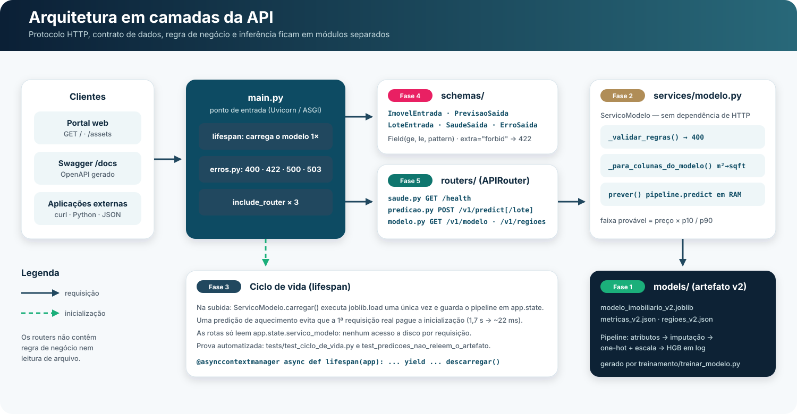
</p>

## M2.7 Fase 1 — Preparação e serialização do modelo

Script: [`modulo2_api/treinamento/treinar_modelo.py`](modulo2_api/treinamento/treinar_modelo.py), organizado em etapas com cabeçalhos em Markdown que justificam cada decisão.

| Etapa | Implementação | Justificativa |
|---|---|---|
| 1 — Carga e limpeza | `carregar_base()` aplica as mesmas regras do Módulo 1 | manter a limpeza já validada e auditada |
| 2 — Divisão | `dividir()`: `GroupShuffleSplit` por `id`, 20 % para teste e 25 % do restante para validação (60/20/20, `random_state` 42), com `assert` de ids disjuntos | uma casa revendida nunca aparece em dois conjuntos, o que evita vazamento |
| 3 — Seleção | `selecionar()`: os candidatos são treinados no treino e comparados na **validação** pelo menor RMSE | o teste não participa da escolha |
| Coerência de negócio | restrições monotônicas crescentes no boosting (`monotonic_cst`) em `sqft_living`, `grade`, `view`, `condition`, `waterfront`, `bathrooms`, `sqft_living15`, `foi_reformado`; o candidato restrito é preferido se perder até 0,01 de R² na validação | o preço estimado não pode cair quando um atributo de valor melhora (por exemplo, mais área ou padrão superior) |
| 4 — Faixa provável | `faixa_erro()`: quantis de 10 % e 90 % da razão real/previsto na validação | a resposta da API expõe a incerteza |
| 5 — Importância | `importancia()`: permutação com `scoring="r2"` numa amostra de 1.500 imóveis da validação | explicar o modelo no portal com custo baixo |
| 6 — Regiões | `regioes()`: preço mediano e US$/m² por CEP | alimentar o mapa de valor |
| Serialização | modelo final reajustado em treino + validação e salvo com `joblib.dump(..., compress=3)` | um arquivo binário dedicado, recarregável e com 337 KB |

O pré-processamento (imputação de nulos, codificação categórica e escalonamento) fica **dentro do `Pipeline` serializado**. Assim, a API recebe dados brutos e aplica exatamente o mesmo tratamento do treino.

**Comparação dos candidatos na validação (4.318 imóveis):**

| Candidato | R² | RMSE (US$) | MAE (US$) | MAPE |
|---|---:|---:|---:|---:|
| Baseline pela média | 0,000 | 360.951 | 232.545 | 53,0 % |
| Regressão Linear | 0,834 | 147.029 | 95.005 | 19,9 % |
| HistGradientBoosting | 0,904 | 111.658 | 64.837 | 12,3 % |
| HistGradientBoosting Log | 0,917 | 104.189 | 61.209 | 11,4 % |
| **HistGradientBoosting Log monotônico** ✅ | **0,911** | **107.916** | **62.654** | **11,6 %** |

**Métricas do modelo escolhido:**

| Conjunto | Imóveis | R² | MSE | RMSE (US$) | MAE (US$) | MAPE |
|---|---:|---:|---:|---:|---:|---:|
| Treino | 12.971 | — | — | — | — | — |
| Validação | 4.318 | 0,911 | 1,16 × 10¹⁰ | 107.916 | 62.654 | 11,6 % |
| **Teste (prova final)** | **4.324** | **0,902** | **1,36 × 10¹⁰** | **116.823** | **63.908** | **12,0 %** |
| Baseline no teste | 4.324 | 0,000 | 1,40 × 10¹¹ | 373.780 | 236.448 | 53,3 % |

**Variáveis mais importantes (queda média do R² ao embaralhar a variável, na validação):** latitude 0,411 · área útil 0,339 · padrão construtivo 0,244 · longitude 0,120 · área útil dos vizinhos 0,034 · vista 0,026 · área do terreno 0,022.

**Restrições monotônicas: com × sem restrição.** Um modelo comercial não pode sugerir que um imóvel vale menos depois de uma reforma ou de um padrão superior. Por isso o boosting em log recebeu restrições monotônicas **crescentes** (`monotonic_cst`) em: área útil (`sqft_living`), padrão construtivo (`grade`), vista (`view`), condição (`condition`), frente para a água (`waterfront`), banheiros (`bathrooms`), área útil dos vizinhos (`sqft_living15`), imóvel reformado (`foi_reformado`).

| Modelo (validação) | R² | RMSE (US$) | MAE (US$) | MAPE |
|---|---:|---:|---:|---:|
| HGB Log sem restrição | 0,9167 | 104.189 | 61.209 | 11,4 % |
| **HGB Log monotônico** ✅ | **0,9106** | **107.916** | **62.654** | **11,6 %** |

A restrição custou só **0,0061 de R² na validação**, dentro do limite de 0,01 fixado no critério de seleção. No teste, o R² ficou em **0,9023**, acima dos 0,8979 da versão sem restrição. O ganho comercial é a garantia de que o preço nunca cai quando o imóvel melhora.

O critério de seleção registrado em `metricas_v2.json` é: *menor RMSE na validação; o HGB Log monotônico é preferido se perder até 0.01 de R² para o HGB Log sem restrição*. A coerência é verificada a cada execução dos testes por `tests/test_coerencia.py` ([M2.13](#m213-testes-automatizados)).

Para reproduzir, rode `python -m modulo2_api.treinamento.treinar_modelo` a partir da raiz. Leva cerca de 30 segundos e regrava `modelo_imobiliario_v2.joblib`, `metricas_v2.json` e `regioes_v2.json`.

## M2.8 Fase 2 — Arquitetura modular em camadas

A aplicação não é um arquivo único. Cada camada tem uma responsabilidade:

| Camada | Arquivo | Responsabilidade | O que **não** faz |
|---|---|---|---|
| `schemas/` | `imovel.py`, `sistema.py` | define o contrato de entrada e de saída (`BaseModel`, `Field`) | não acessa o modelo |
| `services/` | `modelo.py` | carrega o artefato, aplica as regras de negócio, converte m² em pés² e executa a inferência | não conhece HTTP |
| `routers/` | `saude.py`, `predicao.py`, `modelo.py` | `APIRouter` com as rotas e o `response_model` de cada uma | não tem regra de negócio nem lê disco |
| `main.py` | `main.py` | cria a `FastAPI`, registra o `lifespan`, os tratadores de erro e os roteadores e serve o portal | não faz inferência |
| configuração | `config.py`, `erros.py` | caminhos relativos via `pathlib` e tradução de exceções em respostas HTTP | — |

Como a regra de negócio fica isolada no `ServicoModelo`, é possível trocar o modelo ou o protocolo sem reescrever as rotas.

## M2.9 Fase 3 — Ciclo de vida e carga única (lifespan)

<p align="center">
  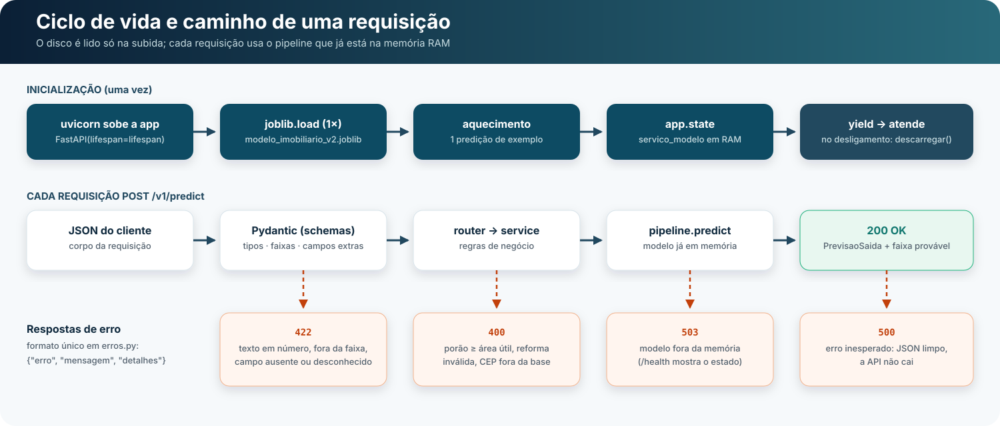
</p>

```python
# modulo2_api/app/main.py
@asynccontextmanager
async def lifespan(app: FastAPI):
    servico = ServicoModelo(ARQUIVO_MODELO, ARQUIVO_METRICAS, ARQUIVO_REGIOES)
    servico.carregar()      # único joblib.load da aplicação
    servico.aquecer()       # 1 predição de exemplo: a 1ª requisição real não paga a inicialização
    app.state.servico_modelo = servico
    yield
    servico.descarregar()

app = FastAPI(..., lifespan=lifespan)
```

- O `joblib.load` aparece só em `ServicoModelo.carregar()` (`modulo2_api/app/services/modelo.py`), chamado uma única vez pelo `lifespan`.
- As rotas recebem o serviço já carregado por injeção de dependência (`routers/dependencias.py`) e **nunca leem o disco**, como exige a proibição técnica do enunciado.
- O aquecimento derrubou a primeira resposta de cerca de 1,7 s para cerca de 22 ms.
- Se o artefato faltar, a API sobe assim mesmo: `/health` mostra `modelo_carregado: false` e `/v1/predict` responde **503**.
- Provas automatizadas:
  - `test_modelo_e_lido_do_disco_uma_unica_vez` conta exatamente **1** leitura do artefato;
  - `test_predicoes_nao_releem_o_artefato` bloqueia o `joblib.load` e mostra que 5 predições seguidas continuam respondendo 200.

## M2.10 Fase 4 — Contratos de dados com Pydantic

**Entrada `ImovelEntrada`** (`modulo2_api/app/schemas/imovel.py`), com `model_config = ConfigDict(extra="forbid")`. Campos desconhecidos são recusados.

| Campo | Tipo | Regra (`Field`) | Descrição |
|---|---|---|---|
| `quartos` | int | 0 ≤ x ≤ 15 | número de quartos |
| `banheiros` | float | 0 ≤ x ≤ 10, múltiplo de 0,25 | banheiros (0,25 = lavabo) |
| `area_util_m2` | float | 25 ≤ x ≤ 1.300 | área útil construída, em m² |
| `area_terreno_m2` | float | 50 ≤ x ≤ 160.000 | área do terreno, em m² |
| `andares` | float | 1 ≤ x ≤ 3,5, múltiplo de 0,5 | pavimentos |
| `frente_agua` | bool | — | imóvel com frente para a água |
| `vista` | int | 0 ≤ x ≤ 4 | qualidade da vista |
| `condicao` | int | 1 ≤ x ≤ 5 | estado de conservação |
| `padrao_construtivo` | int | 1 ≤ x ≤ 13 | padrão construtivo do condado (*grade*) |
| `area_porao_m2` | float | 0 ≤ x ≤ 500, padrão 0 | área do porão, em m² |
| `ano_construcao` | int | 1900 ≤ x ≤ 2015 | ano de construção |
| `ano_reforma` | int ou nulo | 1900 ≤ x ≤ 2100 | ano da última reforma (vazio se nunca reformado) |
| `cep` | str | padrão `^98\d{3}$` | CEP (*zipcode*) de King County |
| `latitude` | float | 47,15 ≤ x ≤ 47,78 | latitude |
| `longitude` | float | −122,52 ≤ x ≤ −121,31 | longitude |
| `area_util_vizinhos_m2` | float, opcional | 25 ≤ x ≤ 1.300 | média dos 15 vizinhos (padrão: a do próprio imóvel) |
| `area_terreno_vizinhos_m2` | float, opcional | 50 ≤ x ≤ 160.000 | média dos 15 vizinhos (padrão: a do próprio imóvel) |

**Saída `PrevisaoSaida`**, declarada como `response_model` da rota:

| Campo | Tipo | Descrição |
|---|---|---|
| `preco_estimado_usd` | float ≥ 0 | preço estimado, em dólares |
| `faixa_provavel_usd` | `{minimo, maximo}` | limites prováveis (quantis 10 % e 90 % do erro) |
| `preco_por_m2_usd` | float ≥ 0 | preço estimado dividido pela área útil |
| `moeda` | str | `"USD"` |
| `referencia_mercado` | str | mercado e período que o modelo representa |
| `versao_modelo` | str | versão do artefato (`"v2"`) |
| `latencia_ms` | float ≥ 0 | tempo de inferência |

Os demais contratos ficam em `schemas/sistema.py`: `SaudeSaida`, `ModeloInfoSaida`, `RegiaoSaida` e `ErroSaida`. O lote (`LoteEntrada`) aceita de 1 a 20 imóveis (`min_length` e `max_length`).

**Prevenção de dados inválidos:** o Pydantic barra a requisição **antes** de ela chegar ao modelo e o tratador de `erros.py` devolve **422** em português, campo a campo:

<p align="center">
  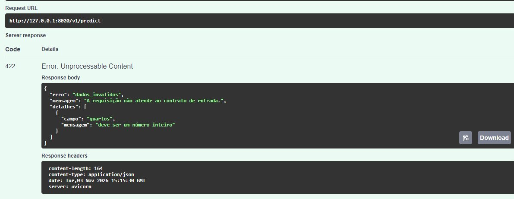
</p>

## M2.11 Fase 5 — Endpoints e tratamento de erros

| Método | Rota | Função | Respostas |
|---|---|---|---|
| GET | `/health` | saúde do serviço; informa se o modelo está na memória RAM | 200 |
| POST | `/v1/predict` | avalia um imóvel | 200 · 400 · 422 · 500 · 503 |
| POST | `/v1/predict/lote` | avalia de 1 a 20 imóveis (simulador de cenários) | 200 · 400 · 422 · 500 · 503 |
| GET | `/v1/modelo` | métricas, divisão dos dados, baseline e importância das variáveis | 200 |
| GET | `/v1/regioes` | preço mediano e US$/m² dos 70 CEPs da base | 200 |

<p align="center">
  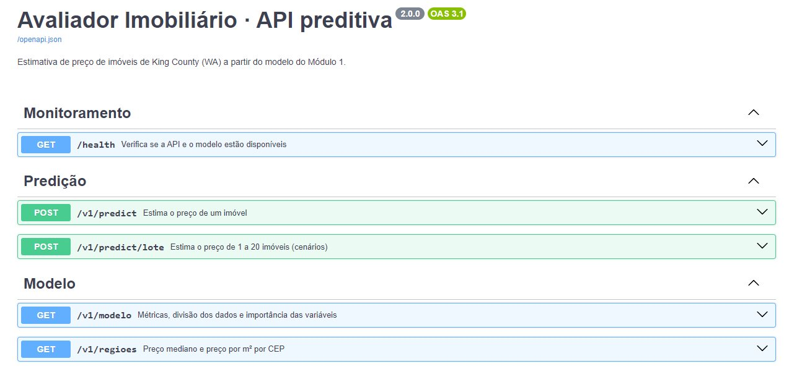
</p>

**`GET /health` — 200 OK**

<p align="center">
  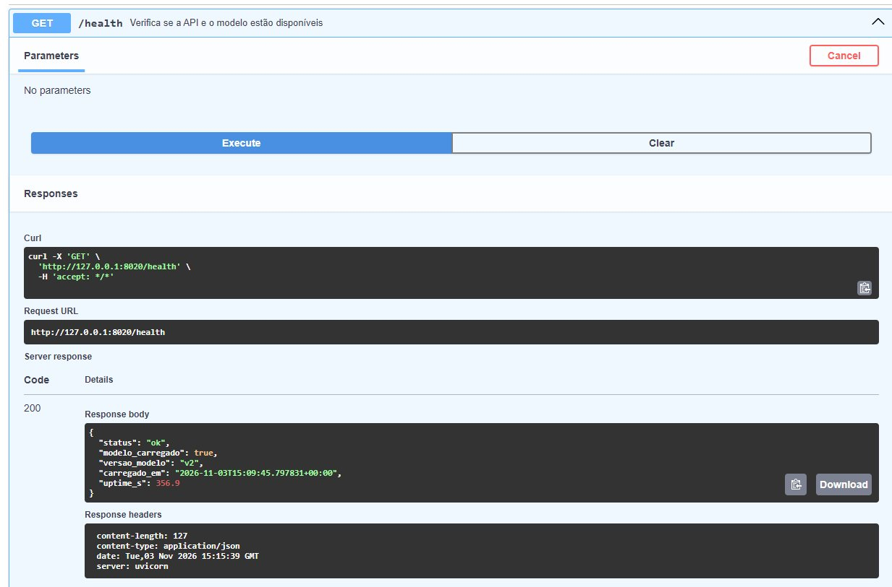
</p>

**`POST /v1/predict` — requisição de exemplo** (áreas em m²):

```json
{
  "quartos": 3,
  "banheiros": 2.25,
  "area_util_m2": 190.0,
  "area_terreno_m2": 670.0,
  "andares": 2.0,
  "frente_agua": false,
  "vista": 0,
  "condicao": 3,
  "padrao_construtivo": 8,
  "area_porao_m2": 40.0,
  "ano_construcao": 1995,
  "ano_reforma": null,
  "cep": "98052",
  "latitude": 47.6768,
  "longitude": -122.1185
}
```

```bash
curl -X POST http://127.0.0.1:8020/v1/predict \
  -H "Content-Type: application/json" \
  -d @exemplo.json
```

**Resposta (200 OK):**

```json
{
  "preco_estimado_usd": 619661.36,
  "faixa_provavel_usd": {
    "minimo": 512088.15,
    "maximo": 731200.4
  },
  "preco_por_m2_usd": 3261.38,
  "moeda": "USD",
  "referencia_mercado": "King County (WA), vendas de mai/2014 a mai/2015",
  "versao_modelo": "v2",
  "latencia_ms": 30.72
}
```

<p align="center">
  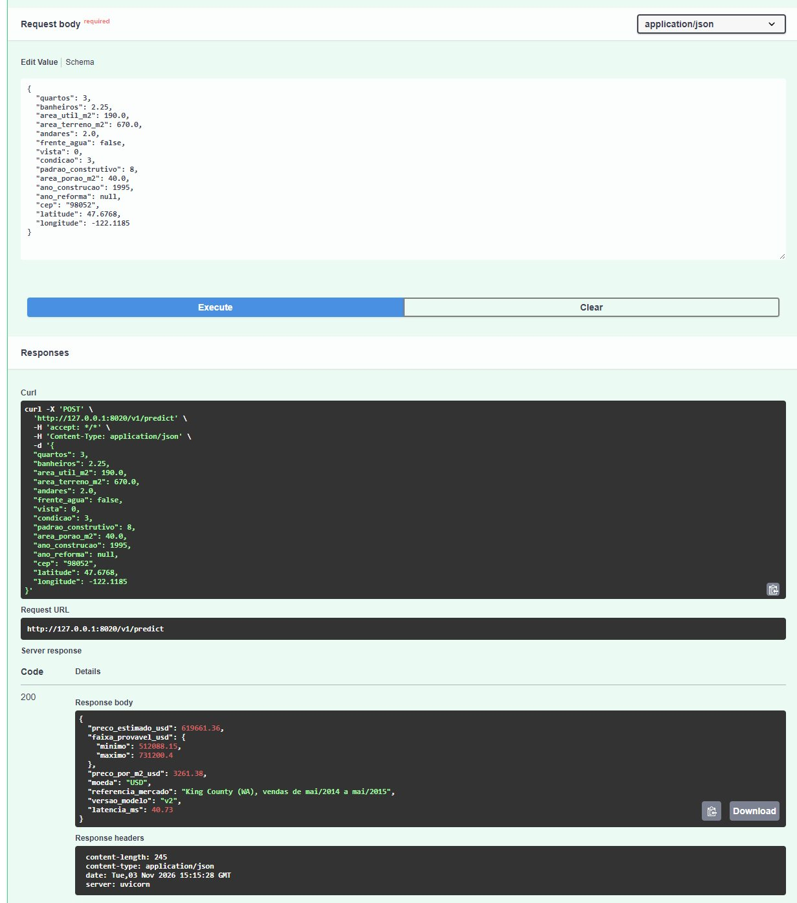
</p>

**Semântica dos códigos HTTP:**

| Código | Quando ocorre | Exemplo de corpo |
|---|---|---|
| **200 OK** | requisição válida e modelo em memória | `PrevisaoSaida` |
| **422 Unprocessable Entity** | o Pydantic recusa o JSON antes do modelo: texto em campo numérico, valor fora da faixa, campo ausente, CEP mal formatado, campo desconhecido, lote com mais de 20 itens ou JSON mal formado | `{"erro": "dados_invalidos", "mensagem": "...", "detalhes": [{"campo": "quartos", "mensagem": "deve ser um número inteiro"}]}` |
| **400 Bad Request** | o JSON é válido, mas viola uma regra de negócio: porão maior ou igual à área útil, reforma anterior à construção ou posterior a 2015, CEP fora da base de treino | `{"erro": "regra_de_negocio", "mensagem": "O ano da reforma é anterior ao ano de construção."}` |
| **500 Internal Server Error** | falha inesperada, capturada pelo tratador global sem derrubar o servidor e sem expor detalhes internos | `{"erro": "erro_interno", "mensagem": "Erro inesperado no servidor. Tente novamente."}` |
| **503 Service Unavailable** | o modelo não está carregado na memória | `{"erro": "modelo_indisponivel", "mensagem": "O modelo não está carregado na memória."}` |

<p align="center">
  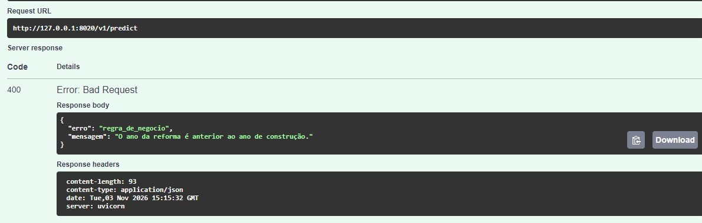
</p>

## M2.12 Portal web Avaliador Imobiliário

O portal leva o modelo além do notebook e mostra como ele seria usado comercialmente. É servido pela própria API em <http://127.0.0.1:8020/> e consome apenas os endpoints públicos acima.

Foi feito em HTML, CSS e JavaScript puros, com mapa vetorial **MapLibre GL JS**, gráficos **Chart.js** e tema claro, escuro ou automático. A interface é responsiva até a largura de celular.

| Módulo | Função | Endpoints |
|---|---|---|
| Início | proposta de valor, KPIs do modelo e status ao vivo da API, atualizado a cada 15 s | `/health`, `/v1/modelo` |
| Avaliar imóvel | formulário em três grupos (estrutura, qualidade e localização), com mapa interativo e resultado com preço, faixa provável e US$/m² comparado à mediana do CEP | `/v1/predict`, `/v1/regioes` |
| Simulador de cenários | reforma, banheiro extra, ampliação, padrão e vista numa única chamada em lote, com gráfico e tabela de variação | `/v1/predict/lote` |
| Mapa de valor | camada de CEPs com cor pelo US$/m² e raio pelo número de vendas, ligada a um ranking em barras | `/v1/regioes`, `/v1/predict` |
| Modelo | validação × teste × baseline, divisão dos dados e importância das variáveis | `/v1/modelo` |
| Desenvolvedores | Swagger, exemplos em curl e Python e tabelas de endpoints e códigos HTTP | — |

**Interação entre os módulos.** Todos os módulos leem um único estado compartilhado, com o imóvel atual e o CEP selecionado. Uma mudança feita num módulo aparece nos outros.

| Ação do usuário | Resposta da interface |
|---|---|
| Clicar em qualquer ponto do mapa em **Avaliar** | o marcador se move, o CEP mais próximo é escolhido, `POST /v1/predict` é disparado na hora, o valor e a faixa aparecem num *popup* no mapa e o cartão de resultado é atualizado |
| Passar o mouse ou clicar num CEP no **Mapa de valor** | a barra correspondente do ranking é destacada |
| Clicar numa barra do ranking | o mapa voa até o CEP (`flyTo`) e destaca o círculo |
| Clicar num ponto vazio do **Mapa de valor** | o imóvel do formulário é estimado naquele local, com *popup* de preço e o atalho "Abrir na avaliação" |
| Clicar numa barra do **Simulador** | o cenário é aplicado ao formulário (com aviso) e passa a ser o imóvel atual |
| Clicar numa variável da importância em **Modelo** | o portal vai até o campo correspondente do formulário e o destaca |
| Enviar dados incoerentes | as mensagens 400 e 422 da API aparecem campo a campo |

<p align="center">
  
</p>

<p align="center">
  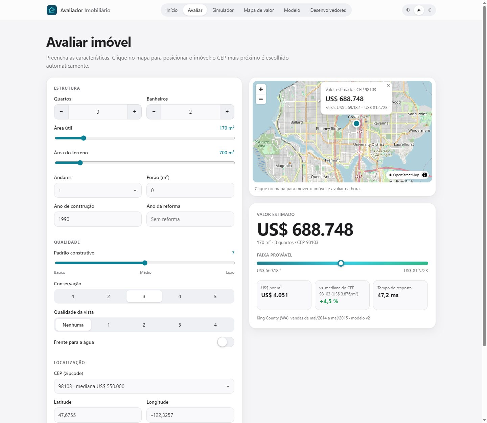
</p>

<p align="center">
  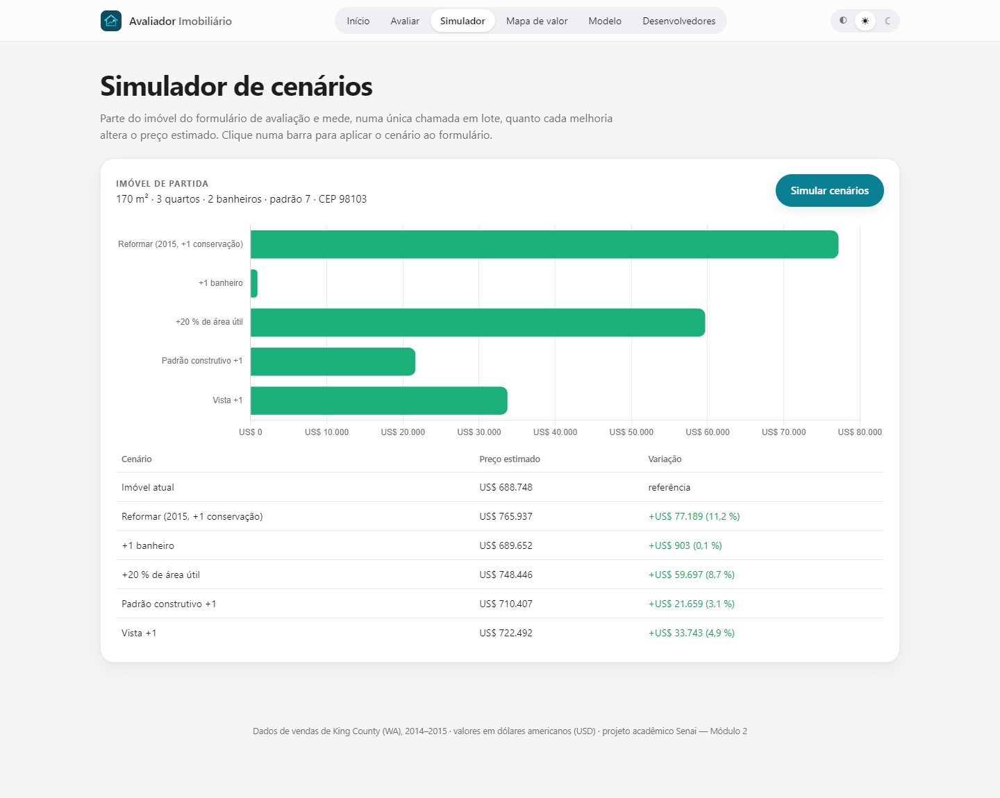
</p>

<p align="center">
  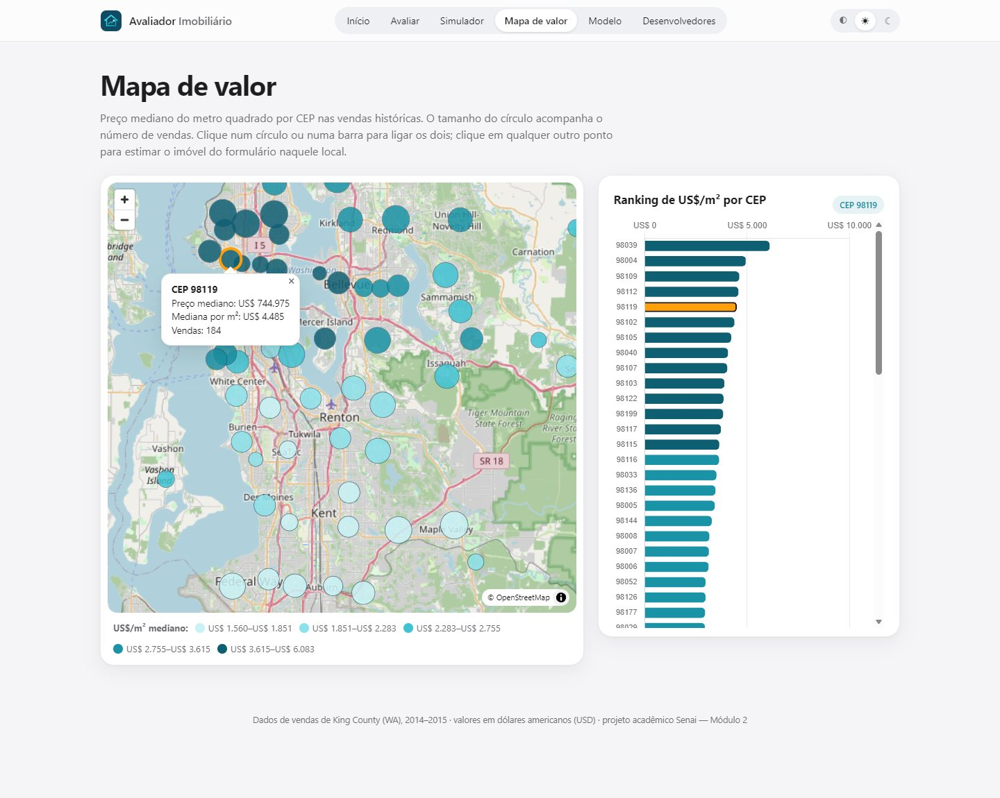
</p>

<p align="center">
  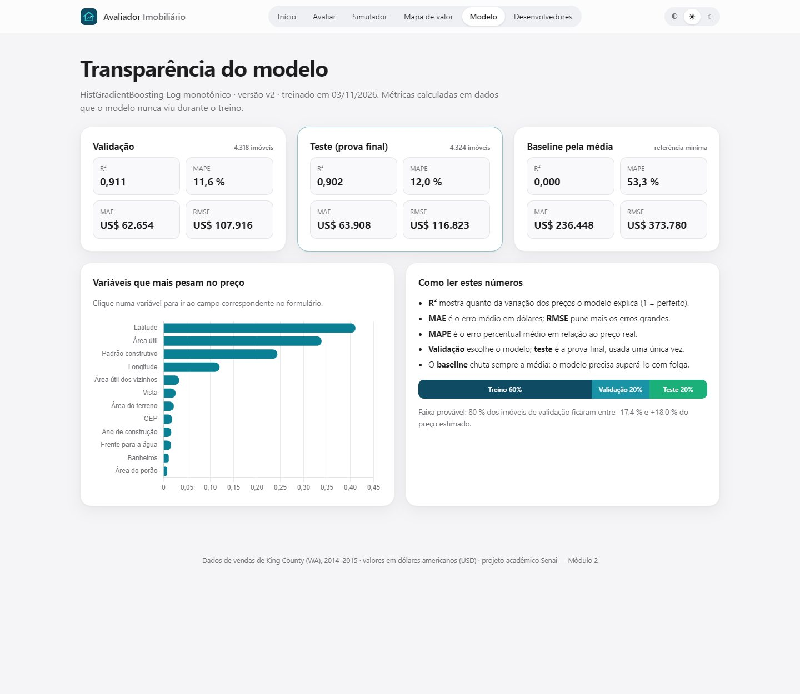
</p>

<p align="center">
  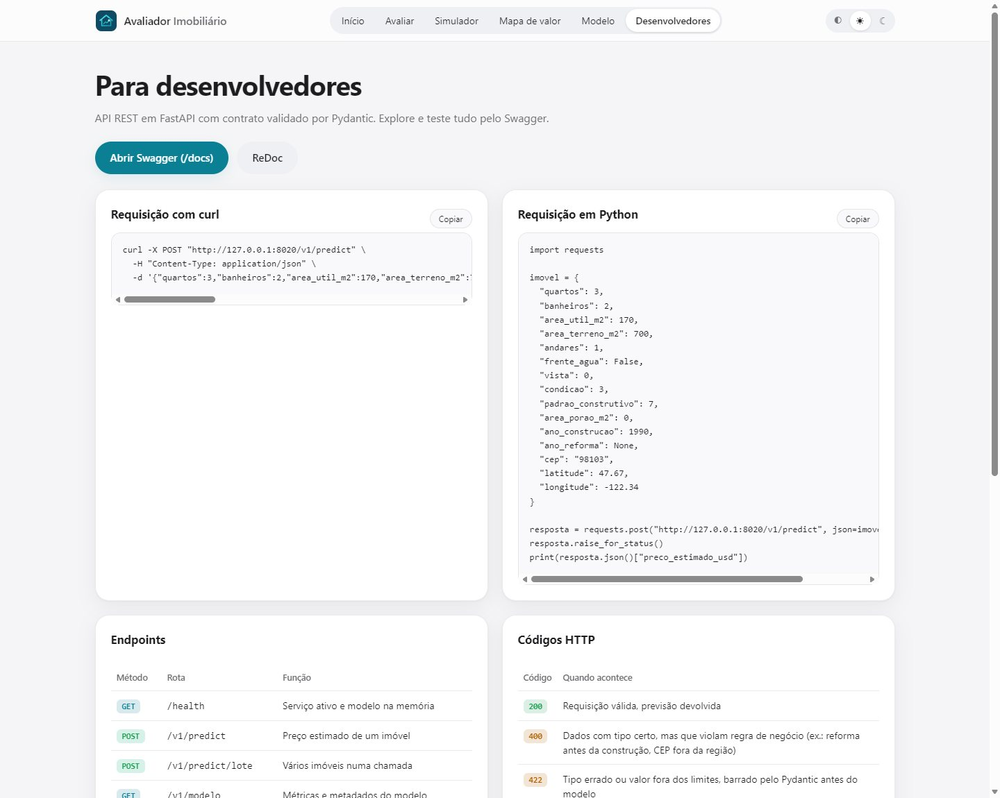
</p>

<table>
  <tr>
    <td width="68%">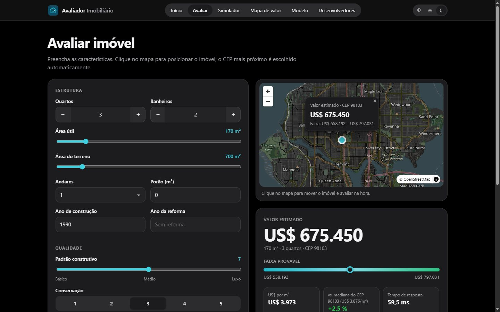</td>
    <td width="32%"></td>
  </tr>
  <tr>
    <td align="center">Tema escuro</td>
    <td align="center">Largura de celular (375 px)</td>
  </tr>
</table>

## M2.13 Testes automatizados

Os testes usam o `TestClient` do FastAPI, com o `lifespan` real, e ficam em [`modulo2_api/tests/`](modulo2_api/tests/).

| # | Teste | O que comprova | Código |
|---:|---|---|:---:|
| 1 | `test_lifespan_carrega_modelo_na_memoria` | o `lifespan` deixa o modelo na RAM | 200 |
| 2 | `test_modelo_e_lido_do_disco_uma_unica_vez` | exatamente 1 `joblib.load` na vida da aplicação | — |
| 3 | `test_health_200` | `/health` informa serviço ativo e modelo carregado | 200 |
| 4 | `test_predict_200` | predição individual no formato `PrevisaoSaida` | 200 |
| 5 | `test_predict_lote_200` | predição em lote | 200 |
| 6 | `test_modelo_e_regioes_200` | métricas (R² do teste > 0,8) e 70 regiões | 200 |
| 7–11 | `test_predict_422[...]` | texto em número, fora da faixa, campo ausente, CEP inválido e campo desconhecido | 422 |
| 12 | `test_lote_acima_do_limite_422` | lote com 21 itens | 422 |
| 13–16 | `test_predict_400[...]` | porão ≥ área útil, reforma antes da construção, reforma depois de 2015 e CEP fora da base | 400 |
| 17 | `test_predict_500` | falha simulada no modelo vira JSON limpo, sem derrubar a API | 500 |
| 18 | `test_predict_503_sem_modelo` | modelo fora da memória | 503 |
| 19 | `test_predicoes_nao_releem_o_artefato` | 5 predições com `joblib.load` bloqueado | 200 |
| 20–24 | `test_melhorias_nao_reduzem_o_preco[cep]` | coerência comercial em 5 CEPs (98103, 98065, 98052, 98004, 98118): padrão +1, área +20 %, vista +1 e reforma nunca reduzem o preço estimado | 200 |

<p align="center">
  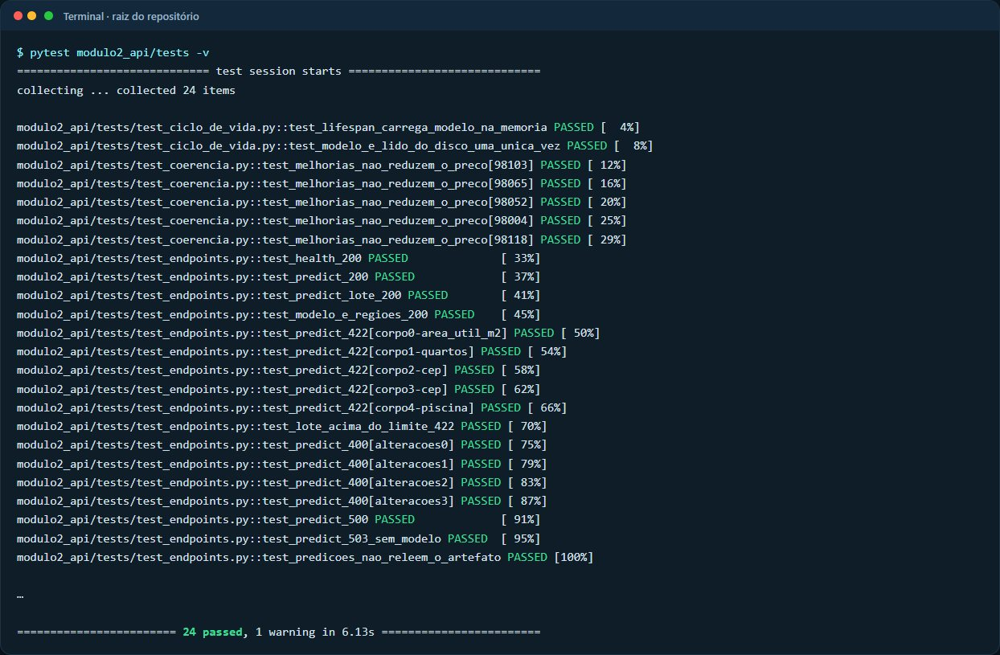
</p>

> O único aviso do `pytest` é uma depreciação interna do Starlette sobre o `httpx` usado pelo `TestClient`. Ele não afeta a API nem os resultados.

## M2.14 Como executar

Todos os comandos são executados na **raiz do repositório**, depois do `git clone`. Os caminhos do projeto são relativos e resolvidos por `pathlib` (`modulo2_api/app/config.py` e `treinamento/treinar_modelo.py`), sem nenhum caminho absoluto da máquina. A base fica em `data/raw/`.

```bash
# 1. Ambiente virtual (Python 3.13)
python -m venv .venv
# Windows
.venv\Scripts\activate
# Linux / macOS
source .venv/bin/activate

# 2. Dependências (Módulo 1 + Módulo 2)
pip install -r requirements.txt

# 3. (opcional) Retreinar e serializar o modelo v2
python -m modulo2_api.treinamento.treinar_modelo

# 4. Subir a API com Uvicorn
uvicorn modulo2_api.app.main:app --port 8020

# 5. Rodar os testes automatizados
pytest modulo2_api/tests -q
```

Com o servidor no ar:

| Endereço | Conteúdo |
|---|---|
| <http://127.0.0.1:8020/> | portal web |
| <http://127.0.0.1:8020/docs> | Swagger UI, para testar os endpoints |
| <http://127.0.0.1:8020/redoc> | ReDoc |
| <http://127.0.0.1:8020/health> | status do serviço |

Consumo a partir de Python:

```python
import httpx

imovel = {"quartos": 3, "banheiros": 2.25, "area_util_m2": 190, "area_terreno_m2": 670,
          "andares": 2, "frente_agua": False, "vista": 0, "condicao": 3, "padrao_construtivo": 8,
          "area_porao_m2": 40, "ano_construcao": 1995, "ano_reforma": None, "cep": "98052",
          "latitude": 47.6768, "longitude": -122.1185}
resposta = httpx.post("http://127.0.0.1:8020/v1/predict", json=imovel)
print(resposta.status_code, resposta.json()["preco_estimado_usd"])
```

## M2.15 Dependências e reprodutibilidade

| Biblioteca | Versão | Finalidade |
|---|---:|---|
| Python | 3.13 | linguagem e execução |
| pandas | 2.2.3 | carga e montagem das linhas de entrada do pipeline |
| NumPy | 2.3.5 | cálculo numérico |
| scikit-learn | 1.8.0 | pipeline, pré-processamento, modelos e métricas |
| SciPy | 1.17.0 | dependência numérica do scikit-learn |
| joblib | 1.5.3 | serialização do artefato `.joblib` |
| FastAPI | 0.162.0 | framework da API, `APIRouter` e OpenAPI/Swagger |
| Pydantic | 2.14.2 | validação estrita dos contratos |
| Uvicorn (`[standard]`) | 0.54.0 | servidor ASGI |
| httpx | 0.28.1 | cliente HTTP do `TestClient` |
| pytest | 9.2.0 | testes automatizados |

- [`requirements.txt`](requirements.txt), na raiz: cobre o Módulo 1 (incluindo matplotlib, seaborn, h3, plotly e jinja2) e o Módulo 2.
- [`modulo2_api/requirements.txt`](modulo2_api/requirements.txt): só o necessário para a API e os testes.
- As versões do pipeline são as mesmas do Módulo 1, o que garante a compatibilidade do artefato com o código de `src/`.
- O `.venv/` fica fora do versionamento (`.gitignore`).

## M2.16 Organização do trabalho e uso do GitHub

**Planejamento antes do código.** O enunciado foi decomposto nas cinco fases técnicas, mais o portal e a documentação. Cada tarefa ganhou um *feature branch* próprio, criado a partir da `develop`, e a ordem seguiu as dependências: o modelo vem antes da estrutura; a estrutura, antes do ciclo de vida; o ciclo de vida, antes dos contratos; os contratos, antes dos endpoints e testes; e só então vêm o portal e o README.

<p align="center">
  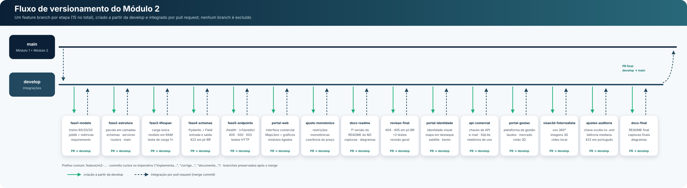
</p>

| Branch | Objetivo |
|---|---|
| `develop` | concentrar as integrações do Módulo 2 durante o desenvolvimento |
| `feature/m2-fase1-modelo` | treinar, validar, testar e serializar o modelo v2; fixar as dependências |
| `feature/m2-fase2-estrutura` | criar o pacote da API em camadas |
| `feature/m2-fase3-lifespan` | carregar o modelo uma única vez no ciclo de vida, com teste |
| `feature/m2-fase4-schemas` | contratos Pydantic de entrada e saída e tratamento do 422 |
| `feature/m2-fase5-endpoints` | endpoints, regras de negócio (400), erros 500/503 e testes |
| `feature/m2-portal-web` | portal web que consome a API, com mapa MapLibre e interação entre os módulos |
| `feature/m2-ajuste-monotonico` | garantir a coerência de negócio do preço com restrições monotônicas no modelo |
| `feature/m2-docs-readme` | documentação do Módulo 2, diagramas e capturas |
| `main` | versão final, com todo o código integrado |

**Boas práticas adotadas:**

- commits curtos, no imperativo e com poucos arquivos cada, por exemplo:
  - `implementa treino do modelo v2 com divisão treino, validação e teste`;
  - `carrega o modelo uma única vez no lifespan`;
  - `padroniza respostas de erro 422 em português`;
  - `corrige campo informado no erro de JSON malformado`;
- cada *feature branch* é integrado à `develop` por *pull request* com *merge commit*;
- **nenhum branch é excluído** depois do PR;
- ao final, a `develop` é integrada à `main`, que concentra todo o código final.

## M2.17 Cobertura dos critérios de avaliação

**Critérios da seção 6 do enunciado**

| Nº | Critério (nota máxima) | Como o projeto atende | Evidência |
|:---:|---|---|---|
| 1 | Gravação do vídeo (2,0) | vídeo de até 10 min, com rosto visível, cobrindo os seis tópicos do item 5.4 | link em [M2.21](#m221-evidências-e-vídeo) |
| 2 | Branches e commits (1,5) | `develop`, um *feature branch* por fase, PRs para a `develop`, nenhum branch excluído, merge final na `main` e commits curtos no imperativo | [M2.16](#m216-organização-do-trabalho-e-uso-do-github), aba *Branches* e *Pull requests* do GitHub, `git log --graph --all` |
| 3 | README completo (1,5) | os seis tópicos do item 5.2 (tabela abaixo) e mais arquitetura, testes, capturas e cobertura | este documento |
| 4 | Fase 1: serialização e modelo (1,0) | treino, validação e teste em 60/20/20 por `id`; imputação, one-hot e escala no `Pipeline`; artefato `.joblib` em `modulo2_api/models/`; métricas documentadas | [M2.7](#m27-fase-1--preparação-e-serialização-do-modelo), `treinar_modelo.py` (`dividir`, `selecionar`, `joblib.dump`), `metricas_v2.json` |
| 5 | Fase 2: arquitetura modular (1,0) | camadas `schemas/`, `services/`, `routers/` e `main.py`; nenhuma regra de negócio nas rotas | [M2.6](#m26-estrutura-do-módulo-2), [M2.8](#m28-fase-2--arquitetura-modular-em-camadas), diagrama de arquitetura |
| 6 | Fase 3: ciclo de vida (1,0) | `@asynccontextmanager lifespan` carrega o artefato uma única vez e o mantém na RAM; as rotas não leem o disco | [M2.9](#m29-fase-3--ciclo-de-vida-e-carga-única-lifespan), `main.py` (`lifespan`), testes 2 e 19 |
| 7 | Fase 4: Pydantic (1,0) | `BaseModel` de entrada e saída com `Field` (`ge`, `le`, `pattern`, `multiple_of`, `description`), `extra="forbid"`, `response_model` em todas as rotas e 422 consistente | [M2.10](#m210-fase-4--contratos-de-dados-com-pydantic), `schemas/imovel.py`, testes 7 a 12, captura do 422 |
| 8 | Fase 5: endpoints e erros (1,0) | `/health` e `/v1/predict` funcionando no `/docs` com 200, 422 e 400, além de 500 e 503 tratados | [M2.11](#m211-fase-5--endpoints-e-tratamento-de-erros), capturas do Swagger, testes 3 a 19 |

**Requisitos da seção 5 do enunciado**

| Item | Requisito | Como o projeto atende |
|---|---|---|
| 5.1 | Entrega em `.py` ou `.ipynb` | Python puro em `modulo2_api/`; o Módulo 1 segue em notebook |
| 5.1 | Código limpo e explicativo | cada módulo abre com cabeçalho em Markdown (`# ...`, `## ...`) que explica a fase e justifica as decisões; o treino é dividido em etapas comentadas |
| 5.1 | `requirements.txt` | na raiz (completo) e em `modulo2_api/` (mínimo), com versões exatas |
| 5.1 | Caminhos relativos e pasta de dados | base em `data/raw/`; caminhos resolvidos por `pathlib` a partir de `__file__`, sem caminho absoluto |
| 5.2.1 | Nome e resumo do problema de negócio | [M2.1](#m21-identificação) a [M2.3](#m23-problema-de-negócio) |
| 5.2.2 | Origem do modelo | [M2.4](#m24-origem-do-modelo--opção-a) |
| 5.2.3 | Tecnologias e versões | [M2.15](#m215-dependências-e-reprodutibilidade) |
| 5.2.4 | Instalação e execução (venv, requirements, Uvicorn) | [M2.14](#m214-como-executar) |
| 5.2.5 | Documentação da API (payload JSON e `/docs`) | [M2.10](#m210-fase-4--contratos-de-dados-com-pydantic) e [M2.11](#m211-fase-5--endpoints-e-tratamento-de-erros) |
| 5.2.6 | Link do vídeo | [M2.21](#m221-evidências-e-vídeo) |
| 5.3 | Uso do GitHub | [M2.16](#m216-organização-do-trabalho-e-uso-do-github) |
| 5.4 | Vídeo: objetivo e demonstração, execução, organização das tarefas, branches, melhorias e argumentação | tópicos cobertos no vídeo de [M2.21](#m221-evidências-e-vídeo) |
| 8 | Uso de inteligência artificial | declarado na [seção 21](#21-transparência-sobre-uso-de-ia) |

## M2.18 Decisões técnicas

| Decisão | Alternativa descartada | Motivo |
|---|---|---|
| Reaproveitar o pipeline do Módulo 1 (Opção A) | treinar um modelo novo do zero | modelo já validado; o foco do módulo é MLOps e back-end |
| Divisão 60/20/20 agrupada por `id` | divisão aleatória simples | revendas da mesma casa provocariam vazamento entre conjuntos |
| Restrições monotônicas crescentes no boosting | boosting sem restrição | perda de apenas 0,0061 de R² na validação (limite 0,01) em troca de coerência comercial: reforma, área, padrão ou vista melhores nunca reduzem o preço |
| Boosting em escala log com *smearing* | regressão no preço bruto | o preço tem assimetria de 4,0; o log estabiliza o erro e o *smearing* corrige o viés ao voltar para dólares |
| Pré-processamento dentro do `Pipeline` | tratar os dados na rota | o mesmo tratamento do treino é aplicado na inferência, sem duplicar código |
| `joblib` com `compress=3` | `pickle` sem compressão | formato recomendado para objetos do scikit-learn; o artefato tem 337 KB |
| Entrada em m², convertida para pés² no serviço | expor as unidades originais da base | contrato mais natural para o usuário; a conversão é regra de negócio do *service* |
| 422 para contrato e 400 para regra de negócio | um único código de erro | o cliente distingue "JSON mal formado" de "dado incoerente" |
| `extra="forbid"` | aceitar e ignorar campos extras | evita contrato ambíguo e erro de digitação silencioso |
| Aquecimento no `lifespan` | carga preguiçosa na 1ª requisição | a 1ª resposta cai de ~1,7 s para ~22 ms |
| Portal em HTML/CSS/JS servido pela API | framework de front-end separado | nenhuma dependência extra para o avaliador; a API e o portal sobem com um único comando |

## M2.19 Limitações

- Os dados são de 2014–2015 e de um único condado dos EUA; os preços estão em dólares e não refletem o mercado atual.
- A faixa provável é empírica (quantis do erro na validação), não um intervalo conformal com garantia estatística.
- O erro relativo é maior nos imóveis de alto padrão, como já diagnosticado no Módulo 1.
- A API não tem autenticação nem limite de requisições; isso é adequado para uso acadêmico, não para exposição pública.
- O portal usa bibliotecas por CDN, então o mapa e os gráficos precisam de internet; a API e o Swagger funcionam sem ela.

## M2.20 Próximas melhorias

- Autenticação por chave de API e controle de uso por cliente.
- Registro das predições em banco de dados, como SQLite ou PostgreSQL, para auditoria e monitoramento de *drift*.
- Versionamento e acompanhamento dos modelos com MLflow.
- Retreino com dados atuais, validação temporal e intervalos conformais.
- Empacotamento em contêiner Docker, CI com os testes e publicação em nuvem.

## M2.21 Evidências e vídeo

| Evidência | Local |
|---|---|
| Código da API | [`modulo2_api/app/`](modulo2_api/app/) |
| Artefato e métricas | [`modulo2_api/models/`](modulo2_api/models/) |
| Testes | [`modulo2_api/tests/`](modulo2_api/tests/): 24 aprovados |
| Capturas do Swagger, do pytest e do portal | [`assets/modulo2/`](assets/modulo2/) |
| Transparência sobre o uso de IA | [seção 21](#21-transparência-sobre-uso-de-ia) |

---

# Módulo 1 — Pipeline preditivo em notebook

> A documentação a seguir é a do Módulo 1, mantida sem alterações de conteúdo. O modelo v1 descrito aqui deu origem ao modelo v2 servido pela API do Módulo 2.

## 1. Identificação

| Campo | Informação |
|---|---|
| Curso | Desenvolvimento em IA para Análise Preditiva |
| Projeto | Projeto Avaliativo Final — Módulo I |
| Professor | Maurício Costa Cordeiro |
| Aluno | Ricardo Pasquali dos Reis |
| Dataset | King County House Sales — Opção A |
| Ambiente de desenvolvimento | Google Colab |
| Problema | Regressão supervisionada |
| Variável-alvo | `price`, preço de venda em dólares |
| Modelo entregue | HistGradientBoosting com alvo logarítmico e correção de retransformação — v1 |
| Repositório | [rica-ia/Modelo-Preditivo-Imobiliario](https://github.com/rica-ia/Modelo-Preditivo-Imobiliario/) |

---

## 2. Visão geral

O projeto estima uma referência inicial para o preço de venda de imóveis residenciais de King County, no estado de Washington. A solução percorre as seis fases da proposta avaliativa: análise exploratória, limpeza, engenharia de atributos, preparação, modelagem e avaliação com versionamento.

Desenvolvimento, execução e versionamento são realizados no Google Colab com **um único notebook**. A versão acadêmica está organizada em preparação, seis fases avaliativas explícitas e conclusão. Durante a construção, comandos de checkpoint, branch e merge ocupam células temporárias; antes de cada registro, somente a versão sanitizada é indexada. A `develop` concentra as fases, enquanto `experiment/modelos` isola a comparação dos algoritmos e só retorna por merge após a validação. README e módulos permanecem como arquivos independentes no repositório.

A média do treino fornece a referência ingênua, e a Regressão Linear funciona como baseline aprendido e interpretável. Dois modelos não lineares ampliam a comparação: HistGradientBoosting no preço original e HistGradientBoosting treinado em `log1p(price)`, com correção de retransformação aprendida somente no treino. O campeão é escolhido pelo menor RMSE médio em validação cruzada agrupada; o teste permanece isolado até essa decisão.

O resultado apoia triagem, priorização e definição de faixa inicial. Ele não substitui vistoria, análise de comparáveis ou laudo, sobretudo no segmento de alto padrão.

---

## 3. Problema preditivo

> **Objetivo:** prever `price`, uma variável numérica contínua expressa em dólares, a partir de características físicas, temporais e geográficas disponíveis antes da venda.

Uma estimativa acompanhada de erro conhecido pode apoiar:

- triagem e priorização do portfólio;
- definição de uma faixa inicial de anúncio;
- identificação de preços muito afastados do padrão observado;
- encaminhamento dos casos de maior risco para avaliação especializada.

O modelo estima um preço provável condicionado à base histórica; não determina valor justo e não garante uma margem individual de erro.

---

## 4. Dataset e qualidade inicial

| Item | Resultado |
|---|---:|
| Registros | 21.613 vendas realizadas em 2014–2015 |
| Colunas | 21 |
| Faixa do alvo | US$ 75 mil a US$ 7,7 milhões |
| Mediana do alvo | US$ 450 mil |
| Duplicatas integrais | 0 |
| Imóveis com revenda | 176 |
| Registros adicionais de revenda | 177 |
| Valores ausentes | 2 em `sqft_above` |
| Incompatibilidades entre quartos e área | 1 |
| Vendas anteriores ao ano de construção registrado | 12 |

IDs repetidos foram preservados porque representam novos eventos de venda, com datas e preços próprios. Para impedir que duas vendas do mesmo imóvel contaminem a avaliação, todas as divisões de treino, validação e teste são agrupadas por `id`.

A cópia bruta utilizada pelo notebook está disponível em [`kc_house_data.csv`](https://drive.google.com/file/d/1XMw1aKYqfFA13AbOzd9zRElv216bCxqZ/view?usp=sharing). A Célula 0 faz o download anônimo e aceita o arquivo somente quando o SHA-256 corresponde a `aa501a2b18e0d0a288a0fdeb043b2c89d6c7e2ead1f9588165537d4e4e12b9df`.

---

## 5. Resultado executivo

| Indicador do campeão no teste isolado | Resultado |
|---|---:|
| Treino / teste | 17.289 / 4.324 registros |
| IDs presentes nos dois conjuntos | **0** |
| MAE | **US$ 64.720** |
| MSE | US$ 14.577.071.521 |
| RMSE | **US$ 120.736** |
| R² | **0,8956** |
| MAPE | **11,95%** |
| Erros de até US$ 50 mil | 60,4% |
| Erros de até US$ 100 mil | 82,8% |

O MAE equivale a 14,4% da mediana de US$ 450 mil do teste. O modelo explica 89,6% da variação observada no holdout, mas o quartil de maior preço apresenta MAE de US$ 131,4 mil. A qualidade média é adequada para apoio inicial; a cauda de alto valor exige análise especializada.

---

## 6. Estrutura do projeto

<p align="center">
  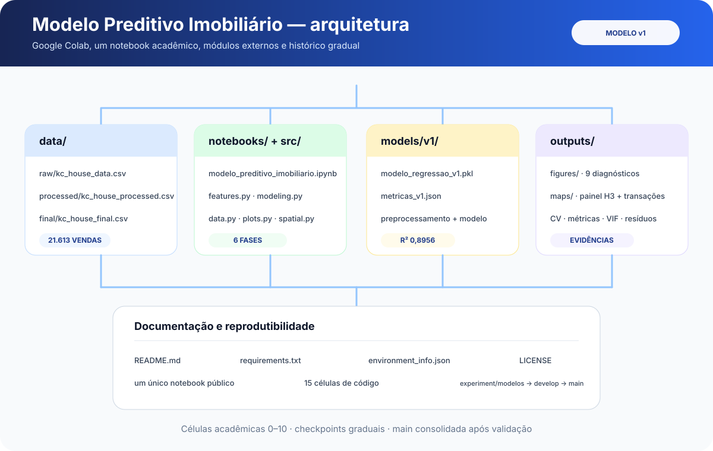
</p>

```text
Modelo-Preditivo-Imobiliario/
├── assets/
│   ├── estrutura_projeto.svg
│   ├── fluxo_branches.svg
│   └── pipeline_preditivo.svg
├── data/
│   ├── raw/kc_house_data.csv
│   ├── processed/kc_house_processed.csv
│   ├── final/kc_house_final.csv
│   └── geospatial/king_county.geojson
├── models/v1/
│   ├── modelo_regressao_v1.pkl
│   └── metricas_v1.json
├── notebooks/
│   └── modelo_preditivo_imobiliario.ipynb
├── outputs/
│   ├── figures/
│   ├── maps/
│   │   ├── painel_geoespacial.html
│   │   ├── regioes_h3_valor_m2.csv
│   │   └── resumo_mapa_valor_m2.json
│   ├── correlacoes_pearson_spearman.csv
│   ├── cv_modelos_folds.csv
│   ├── cv_modelos_resumo.csv
│   ├── diagnostico_distribuicao_alvo.csv
│   ├── diagnostico_generalizacao.csv
│   ├── erros_por_faixa_preco.csv
│   ├── importancia_permutacao.csv
│   ├── metricas_modelos.csv
│   ├── relatorio_qualidade_dados.json
│   ├── resumo_residuos.json
│   ├── vitorias_por_fold.csv
│   ├── vif_antes.csv
│   └── vif_depois.csv
├── src/
│   ├── config.py
│   ├── data.py
│   ├── features.py
│   ├── modeling.py
│   ├── plots.py
│   ├── spatial.py
│   └── templates/painel_geoespacial.html
├── environment_info.json
├── requirements.txt
├── LICENSE
└── README.md
```

---

## 7. Arquivos principais e downloads

O `README.md` é o único arquivo em Markdown. Notebook, módulos, dados, modelo e resultados preservam seus formatos técnicos próprios; guias de autenticação, checkpoints e auditoria ficam fora da versão pública. **Cada nome abaixo é um hyperlink direto para abrir ou baixar o respectivo arquivo.**

### Execução, documentação e arquitetura

| Arquivo | Finalidade |
|---|---|
| [`README.md`](README.md?raw=1) | documentação integral do projeto |
| [`notebooks/modelo_preditivo_imobiliario.ipynb`](notebooks/modelo_preditivo_imobiliario.ipynb?raw=1) | notebook acadêmico validado integralmente, com problema declarado, seis fases explícitas e conclusão |
| [`requirements.txt`](requirements.txt?raw=1) | versões fixadas das dependências |
| [`environment_info.json`](environment_info.json?raw=1) | ambiente efetivamente utilizado |
| [`LICENSE`](LICENSE?raw=1) | licença MIT |
| [`assets/estrutura_projeto.svg`](assets/estrutura_projeto.svg?raw=1) | arquitetura de pastas e artefatos |
| [`assets/pipeline_preditivo.svg`](assets/pipeline_preditivo.svg?raw=1) | fluxo analítico da base bruta ao modelo v1 |
| [`assets/fluxo_branches.svg`](assets/fluxo_branches.svg?raw=1) | caminho de `main`, `develop` e `experiment/modelos` |

### Código-fonte e template

| Arquivo | Finalidade |
|---|---|
| [`src/__init__.py`](src/__init__.py?raw=1) | inicialização do pacote local |
| [`src/config.py`](src/config.py?raw=1) | caminhos, sementes, features e parâmetros |
| [`src/data.py`](src/data.py?raw=1) | leitura e validação da base |
| [`src/features.py`](src/features.py?raw=1) | limpeza, atributos, VIF e preparação dos preditores |
| [`src/modeling.py`](src/modeling.py?raw=1) | pipelines, validação, métricas e retransformação |
| [`src/plots.py`](src/plots.py?raw=1) | gráficos exploratórios e diagnósticos do modelo |
| [`src/spatial.py`](src/spatial.py?raw=1) | agregação H3 e geração do painel geoespacial |
| [`src/templates/painel_geoespacial.html`](src/templates/painel_geoespacial.html?raw=1) | template responsivo do painel Leaflet |

### Dados e modelo versionado

| Arquivo | Finalidade |
|---|---|
| [`data/raw/kc_house_data.csv`](data/raw/kc_house_data.csv?raw=1) | base original preservada |
| [`data/processed/kc_house_processed.csv`](data/processed/kc_house_processed.csv?raw=1) | base limpa e enriquecida |
| [`data/final/kc_house_final.csv`](data/final/kc_house_final.csv?raw=1) | 19 preditores e alvo utilizados na modelagem |
| [`data/geospatial/king_county.geojson`](data/geospatial/king_county.geojson?raw=1) | limite territorial oficial empregado no painel |
| [`models/v1/modelo_regressao_v1.pkl`](models/v1/modelo_regressao_v1.pkl?raw=1) | preprocessamento e modelo final retreinados na base completa |
| [`models/v1/metricas_v1.json`](models/v1/metricas_v1.json?raw=1) | configuração, validação cruzada e métricas do teste |

### Resultados numéricos

| Arquivo | Evidência preservada |
|---|---|
| [`outputs/correlacoes_pearson_spearman.csv`](outputs/correlacoes_pearson_spearman.csv?raw=1) | associações lineares e monotônicas com o alvo |
| [`outputs/diagnostico_distribuicao_alvo.csv`](outputs/diagnostico_distribuicao_alvo.csv?raw=1) | assimetria e curtose do preço antes e depois de `log1p` |
| [`outputs/vif_antes.csv`](outputs/vif_antes.csv?raw=1) | multicolinearidade antes da seleção |
| [`outputs/vif_depois.csv`](outputs/vif_depois.csv?raw=1) | multicolinearidade após a retirada de redundâncias |
| [`outputs/cv_modelos_folds.csv`](outputs/cv_modelos_folds.csv?raw=1) | desempenho por candidato e fold agrupado |
| [`outputs/cv_modelos_resumo.csv`](outputs/cv_modelos_resumo.csv?raw=1) | médias e desvios usados na escolha do campeão |
| [`outputs/vitorias_por_fold.csv`](outputs/vitorias_por_fold.csv?raw=1) | modelo de menor RMSE em cada fold agrupado |
| [`outputs/metricas_modelos.csv`](outputs/metricas_modelos.csv?raw=1) | métricas de treino e teste dos quatro candidatos |
| [`outputs/diagnostico_generalizacao.csv`](outputs/diagnostico_generalizacao.csv?raw=1) | gaps de erro e R² fora da amostra |
| [`outputs/erros_por_faixa_preco.csv`](outputs/erros_por_faixa_preco.csv?raw=1) | risco segmentado por quartil de preço |
| [`outputs/resumo_residuos.json`](outputs/resumo_residuos.json?raw=1) | centro, dispersão e proporções de erro absoluto |
| [`outputs/importancia_permutacao.csv`](outputs/importancia_permutacao.csv?raw=1) | dependência preditiva das variáveis no teste |
| [`outputs/relatorio_qualidade_dados.json`](outputs/relatorio_qualidade_dados.json?raw=1) | auditoria e tratamentos de qualidade |

### Gráficos e painel geoespacial

| Arquivo | Conteúdo |
|---|---|
| [`outputs/figures/01_distribuicao_preco.png`](outputs/figures/01_distribuicao_preco.png?raw=1) | preço original e após `log1p` |
| [`outputs/figures/02_relacoes_preco.png`](outputs/figures/02_relacoes_preco.png?raw=1) | área construída e padrão versus preço |
| [`outputs/figures/03_correlacao_pearson.png`](outputs/figures/03_correlacao_pearson.png?raw=1) | mapa de correlação numérica |
| [`outputs/figures/04_boxplots_outliers.png`](outputs/figures/04_boxplots_outliers.png?raw=1) | diagnóstico de extremos |
| [`outputs/figures/05_validacao_cruzada_modelos.png`](outputs/figures/05_validacao_cruzada_modelos.png?raw=1) | estabilidade fold a fold e redução do RMSE frente à média do treino |
| [`outputs/figures/06_generalizacao_modelos.png`](outputs/figures/06_generalizacao_modelos.png?raw=1) | RMSE e R² de treino versus teste |
| [`outputs/figures/07_real_vs_previsto.png`](outputs/figures/07_real_vs_previsto.png?raw=1) | preços reais e previstos no holdout |
| [`outputs/figures/08_residuos.png`](outputs/figures/08_residuos.png?raw=1) | distribuição e padrão dos resíduos |
| [`outputs/figures/09_importancia_permutacao.png`](outputs/figures/09_importancia_permutacao.png?raw=1) | importância por permutação no teste |
| [`outputs/maps/painel_geoespacial.html`](outputs/maps/painel_geoespacial.html?raw=1) | painel com H3, vendas, filtros, ranking e ajuste de tela |
| [`outputs/maps/regioes_h3_valor_m2.csv`](outputs/maps/regioes_h3_valor_m2.csv?raw=1) | estatísticas e cobertura das 290 células exibidas |
| [`outputs/maps/resumo_mapa_valor_m2.json`](outputs/maps/resumo_mapa_valor_m2.json?raw=1) | resolução, cobertura, escala e limiar espacial |

---

## 8. Pipeline preditivo e fluxo de branches

### Encadeamento analítico

<p align="center">
  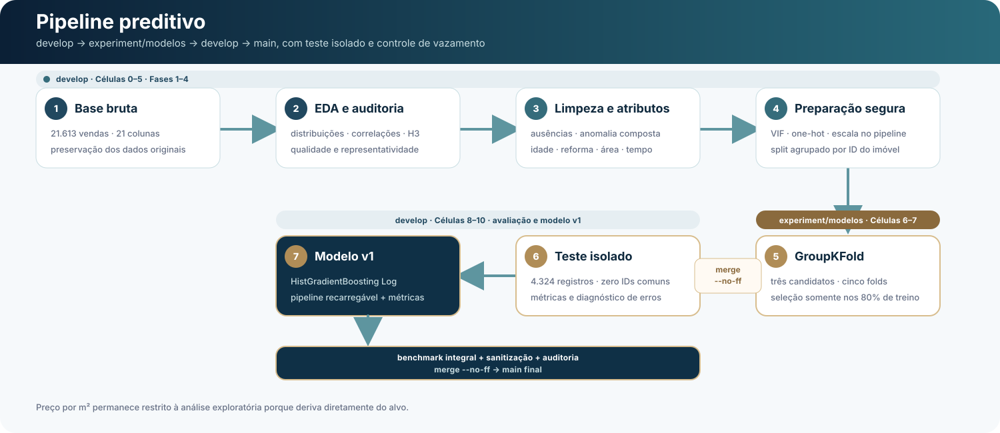
</p>

O holdout é separado por `id` antes da comparação dos algoritmos. O `GroupKFold` opera somente no treino e o teste isolado é consultado após a escolha do campeão.

### Caminho específico da branch experimental

<p align="center">
  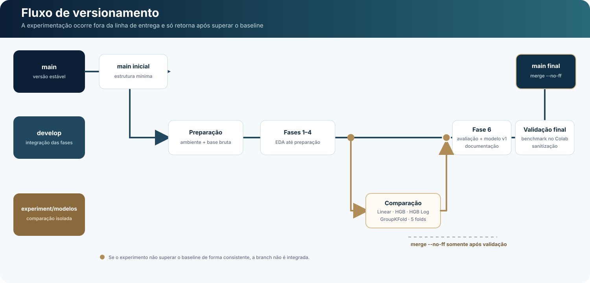
</p>

O caminho efetivo é `main` → `develop` → `experiment/modelos` → `develop` → `main`. A branch experimental nasce da `develop` após a preparação, compara o baseline ingênuo e os três modelos aprendidos e retorna por `merge --no-ff` somente porque o HistGradientBoosting Log venceu os cinco folds. Um resultado insuficiente permaneceria isolado, sem integração funcional à entrega.

| Momento do pipeline | Células | Branch ativa | Regra de integração |
|---|:---:|---|---|
| Preparação e Fases 1–4 | preparação até Fase 4 | `develop` | checkpoints de ambiente, EDA, limpeza, atributos e preparação |
| Comparação dos candidatos | Fase 5 | `experiment/modelos` | branch criada a partir de `develop`; nenhum acesso ao holdout |
| Retorno do experimento | — | `experiment/modelos` → `develop` | `merge --no-ff` apenas se o vencedor superar o baseline nos cinco folds |
| Avaliação e modelo v1 | Fase 6 e conclusão | `develop` | teste isolado, diagnóstico, artefatos e documentação |
| Consolidação da entrega | notebook sanitizado | `develop` → `main` | benchmark integral, auditoria e `merge --no-ff` final |

---

## 9. Cobertura dos requisitos avaliativos

| Requisito | Evidência verificável | Situação |
|---|---|:---:|
| Problema preditivo declarado | abertura do notebook identifica `price`, contexto imobiliário e relevância de negócio | Atendido |
| EDA e estatística descritiva | dimensões, tipos, `.describe()`, assimetria, Pearson, Spearman e mais de três visualizações | Atendido |
| Limpeza fundamentada | auditoria de duplicatas, imputação pela mediana, boxplots e regra composta para a anomalia de quartos | Atendido |
| Engenharia de atributos | idade, reforma, porão, tempo, log de área e preço por m² restrito à análise | Atendido |
| Preparação segura | VIF, one-hot de `zipcode`, escala dentro do pipeline e separação agrupada por `id` | Atendido |
| Modelagem comparativa | média do treino, Regressão Linear e duas alternativas não lineares avaliadas com `GroupKFold` | Atendido |
| Avaliação e interpretação | MAE, MSE, RMSE, R², MAPE, generalização, resíduos, risco por faixa e veredito de negócio | Atendido |
| Versionamento do modelo | pipeline v1 recarregável, métricas preservadas e ambiente registrado | Atendido |
| Estrutura e reprodutibilidade | notebook, `src/`, `data/`, `outputs/`, `models/`, `requirements.txt`, `develop` e `experiment/modelos` | Atendido |

### Encadeamento das seis fases

| Fase | Células | Evidências produzidas | Decisão central |
|---|---:|---|---|
| 1 — EDA | seções 2.1–2.3 | dimensões, tipos, `.describe()`, assimetria, relações com o alvo, Pearson, Spearman e painel geoespacial | reconhecer a cauda de preços, a concentração espacial e os limites de representatividade |
| 2 — Limpeza | seção 3 | duplicatas, revendas, ausências, boxplots e regra composta de anomalia | preservar extremos plausíveis e corrigir apenas o registro incompatível de 33 quartos |
| 3 — Engenharia de atributos | seção 4 | idade, reforma, porão, mês, ano, área e log do terreno | limitar idade a zero em 12 casos e manter `preco_por_m2` fora do modelo |
| 4 — Preparação | seção 5 | VIF antes/depois, `GroupShuffleSplit`, one-hot e escala | reduzir redundância, manter revendas juntas e ajustar transformações somente no treino |
| 5 — Modelagem | seção 6 | referência pela média, Linear, boosting original e boosting log; `GroupKFold` em cinco folds | selecionar o campeão sem consultar o teste |
| 6 — Avaliação | seção 7 | MAE, MSE, RMSE, R², MAPE, gaps, resíduos, quartis, importância e modelo v1 | recomendar uso assistido e cautela no alto padrão |

---

## 10. Decisões técnicas orientadas pelos dados

| Achado | Tratamento | Justificativa |
|---|---|---|
| Nenhuma duplicata integral | nenhuma linha removida | não havia redundância amostral |
| IDs repetidos | revendas mantidas e divisão agrupada por `id` | eventos distintos são válidos, mas não podem atravessar treino e teste |
| 2 nulos em `sqft_above` | mediana de 1.560 ft² | a mediana reduz influência da assimetria; a coluna é depois retirada por redundância |
| 11 quartos em 3.000 ft² | registro preservado | raro, porém plausível: 272,7 ft² por quarto |
| 33 quartos em 1.620 ft² | substituição por 3 quartos | menos de 100 ft² por quarto; mediana de 2.328 imóveis comparáveis igual a 3 |
| 12 vendas com ano de construção posterior | `idade_imovel.clip(lower=0)` | representa venda na planta ou durante a conclusão sem produzir idade negativa |
| Mansões e terrenos extremos | valores preservados | raridade não equivale a erro cadastral |
| `sqft_living = sqft_above + sqft_basement` | remoção de `sqft_above` | elimina multicolinearidade estrutural e preserva área total e porão |
| `log_sqft_lot15` redundante | variável removida | reduz redundância com `log_sqft_lot` |
| `zipcode` nominal | one-hot dentro do pipeline | evita impor ordem e ignora categorias futuras desconhecidas |
| `preco_por_m2` deriva do alvo | uso exclusivo na EDA | impede vazamento direto de `price` |
| Densidade espacial desigual | H3 r7, mediana e mínimo de 20 vendas por célula | evita atribuir destaque a regiões sustentadas por poucas observações |

O VIF máximo cai de aproximadamente 199 mil para 6,57 após a retirada das redundâncias estruturais.

---

## 11. Seleção do modelo

O holdout de 20% é separado por `id` antes da escolha. Nos 80% restantes, `GroupKFold` executa cinco folds com o mesmo preprocessamento para todos os candidatos. O critério fixado previamente é o menor RMSE médio; MAE, R² e MAPE funcionam como verificações de consistência.

| Modelo | MAE médio | RMSE médio | R² médio | MAPE médio |
|---|---:|---:|---:|---:|
| **HistGradientBoosting Log** | **US$ 63.780** | **US$ 119.154** | **0,8933** | **11,99%** |
| HistGradientBoosting | US$ 68.232 | US$ 126.588 | 0,8796 | 13,03% |
| Regressão Linear | US$ 95.806 | US$ 160.244 | 0,8074 | 19,71% |
| Baseline pela média | US$ 232.912 | US$ 365.399 | −0,0001 | 53,39% |

A variante logarítmica vence nos cinco folds, reduz o MAE em **72,6%** e o RMSE em **67,4%** frente ao palpite pela média. A escolha também é coerente com a EDA: `log1p` reduz a assimetria do alvo de **4,024 para 0,428**, e o boosting preserva a capacidade de representar interações e relações não lineares. A correção de retransformação é calculada exclusivamente nos dados de treino de cada ajuste; o holdout não participa dessa decisão.

---

## 12. Treino, teste e generalização

| Modelo | Conjunto | MAE | RMSE | R² | MAPE |
|---|---|---:|---:|---:|---:|
| Baseline pela média | Treino | US$ 232.901 | US$ 365.436 | 0,0000 | 53,39% |
| Baseline pela média | Teste | US$ 236.441 | US$ 373.780 | −0,0003 | 53,30% |
| Regressão Linear | Treino | US$ 95.232 | US$ 159.244 | 0,8101 | 19,60% |
| Regressão Linear | Teste | US$ 95.933 | US$ 161.596 | 0,8130 | 19,67% |
| HistGradientBoosting | Treino | US$ 61.870 | US$ 106.398 | 0,9152 | 12,30% |
| HistGradientBoosting | Teste | US$ 69.097 | US$ 125.599 | 0,8871 | 13,06% |
| **HistGradientBoosting Log** | **Treino** | **US$ 57.189** | **US$ 105.052** | **0,9174** | **10,84%** |
| **HistGradientBoosting Log** | **Teste** | **US$ 64.720** | **US$ 120.736** | **0,8956** | **11,95%** |

No campeão, o R² cai 0,0217 e o RMSE do teste equivale a 1,149 vez o RMSE do treino. Existe perda fora da amostra, mas não colapso de generalização. Em relação à Regressão Linear, o RMSE de teste diminui 25,3%.

---

## 13. Diagnóstico dos erros

| Faixa do preço real | Registros | Preço mediano | MAE | MAPE | P90 do erro absoluto |
|---|---:|---:|---:|---:|---:|
| Q1 — menor preço | 1.081 | US$ 259.000 | US$ 35.573 | 15,70% | US$ 81.032 |
| Q2 | 1.086 | US$ 387.933 | US$ 40.128 | 10,40% | US$ 87.434 |
| Q3 | 1.092 | US$ 538.000 | US$ 53.022 | 9,73% | US$ 115.466 |
| Q4 — maior preço | 1.065 | US$ 845.800 | US$ 131.377 | 12,01% | US$ 294.696 |

O resíduo médio é +US$ 2.729 e a mediana é −US$ 1.930, pequenos diante da escala do alvo. A dispersão cresce no quartil superior, justificando uma regra operacional de revisão humana para imóveis de alto padrão.

---

## 14. Gráficos e evidências

### Painel geoespacial do valor residencial

A malha H3 foi calibrada com os próprios dados. Na resolução 7, o corte mínimo de 20 vendas conserva **20.014 transações (92,6%)** e produz 290 células comparáveis; na resolução 8, o mesmo corte preservaria somente 40,2% das vendas. Por isso, a resolução 7 oferece o melhor equilíbrio entre detalhe territorial e estabilidade amostral.

O decil superior começa em aproximadamente **US$ 3.824/m²**. As três células de maior mediana têm ZIP predominante 98004, entre **US$ 5.657 e US$ 5.896/m²**. O resultado descreve a concentração das vendas de 2014–2015: não representa causalidade, avaliação individual ou informação disponível para alimentar o modelo.

<p align="center">
  <a href="https://htmlpreview.github.io/?https://github.com/rica-ia/Modelo-Preditivo-Imobiliario/blob/main/outputs/maps/painel_geoespacial.html">
    
  </a>
  <a href="outputs/maps/painel_geoespacial.html?raw=1">
    
  </a><br>
  <sub>Camadas H3, transações e sobreposição; filtros, mapas-base, ranking, exportação e ajuste automático à área com vendas visíveis.</sub>
</p>

O painel é o artefato cartográfico da entrega. Ele substitui a geração redundante de PNG e SVG: a exploração permanece navegável, enquanto [`regioes_h3_valor_m2.csv`](outputs/maps/regioes_h3_valor_m2.csv) e [`resumo_mapa_valor_m2.json`](outputs/maps/resumo_mapa_valor_m2.json) preservam os números usados na interpretação. Como o repositório é privado, a prévia por serviço externo pode não receber autorização do GitHub; nesse caso, basta baixar o HTML pelo segundo botão e abri-lo no navegador.

| Posição | ZIP predominante | Mediana | Vendas | Preço mediano |
|---:|---:|---:|---:|---:|
| 1 | 98004 | US$ 5.896/m² | 41 | US$ 1.629.000 |
| 2 | 98004 | US$ 5.843/m² | 95 | US$ 1.650.000 |
| 3 | 98004 | US$ 5.657/m² | 53 | US$ 888.000 |
| 4 | 98112 | US$ 5.424/m² | 52 | US$ 1.520.000 |
| 5 | 98119 | US$ 5.344/m² | 38 | US$ 1.235.000 |

### Evidências visuais centrais

| Arquivo | Conteúdo |
|---|---|
| [`01_distribuicao_preco.png`](outputs/figures/01_distribuicao_preco.png?raw=1) | preço original e após `log1p` |
| [`02_relacoes_preco.png`](outputs/figures/02_relacoes_preco.png?raw=1) | área construída e padrão construtivo versus preço |
| [`03_correlacao_pearson.png`](outputs/figures/03_correlacao_pearson.png?raw=1) | mapa de correlação numérica |
| [`04_boxplots_outliers.png`](outputs/figures/04_boxplots_outliers.png?raw=1) | diagnóstico de extremos |
| [`05_validacao_cruzada_modelos.png`](outputs/figures/05_validacao_cruzada_modelos.png?raw=1) | estabilidade dos candidatos por fold e comparação com a média do treino |
| [`06_generalizacao_modelos.png`](outputs/figures/06_generalizacao_modelos.png?raw=1) | RMSE e R² de treino versus teste |
| [`07_real_vs_previsto.png`](outputs/figures/07_real_vs_previsto.png?raw=1) | preços reais e previstos no holdout |
| [`08_residuos.png`](outputs/figures/08_residuos.png?raw=1) | distribuição e padrão dos resíduos |
| [`09_importancia_permutacao.png`](outputs/figures/09_importancia_permutacao.png?raw=1) | dependência preditiva no teste |
| [`maps/painel_geoespacial.html`](outputs/maps/painel_geoespacial.html?raw=1) | H3, vendas, sobreposição, filtros, ranking, zoom e ajuste às vendas |
| [`maps/regioes_h3_valor_m2.csv`](outputs/maps/regioes_h3_valor_m2.csv?raw=1) | mediana, IQR, preço, área, cobertura e indicador de decil superior |

<table class="visual-grid" width="100%">
  <tr>
    <td width="50%" valign="top" align="center">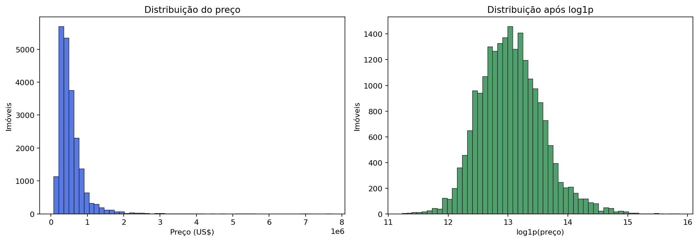<br><b>Distribuição do alvo</b><br><sub>A transformação logarítmica reduz a assimetria de 4,024 para 0,428.</sub></td>
    <td width="50%" valign="top" align="center">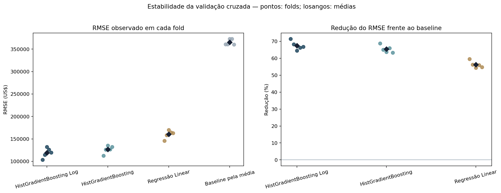<br><b>Seleção no treino</b><br><sub>O modelo logarítmico vence os cinco folds agrupados.</sub></td>
  </tr>
  <tr>
    <td width="50%" valign="top" align="center">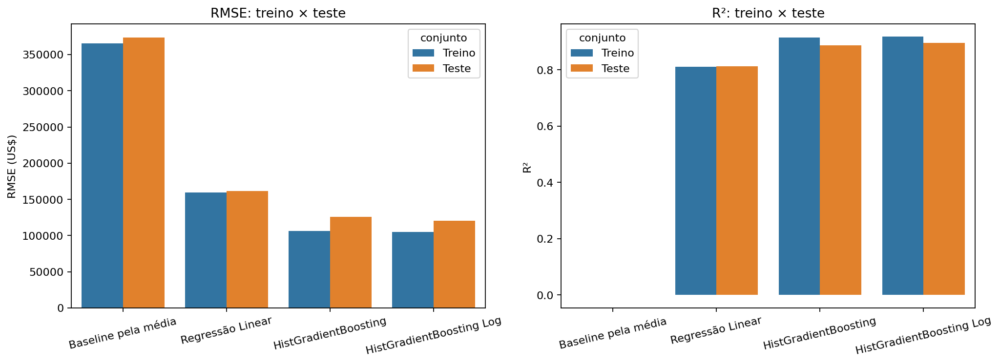<br><b>Treino × teste</b><br><sub>O gap existe, mas não caracteriza colapso fora da amostra.</sub></td>
    <td width="50%" valign="top" align="center">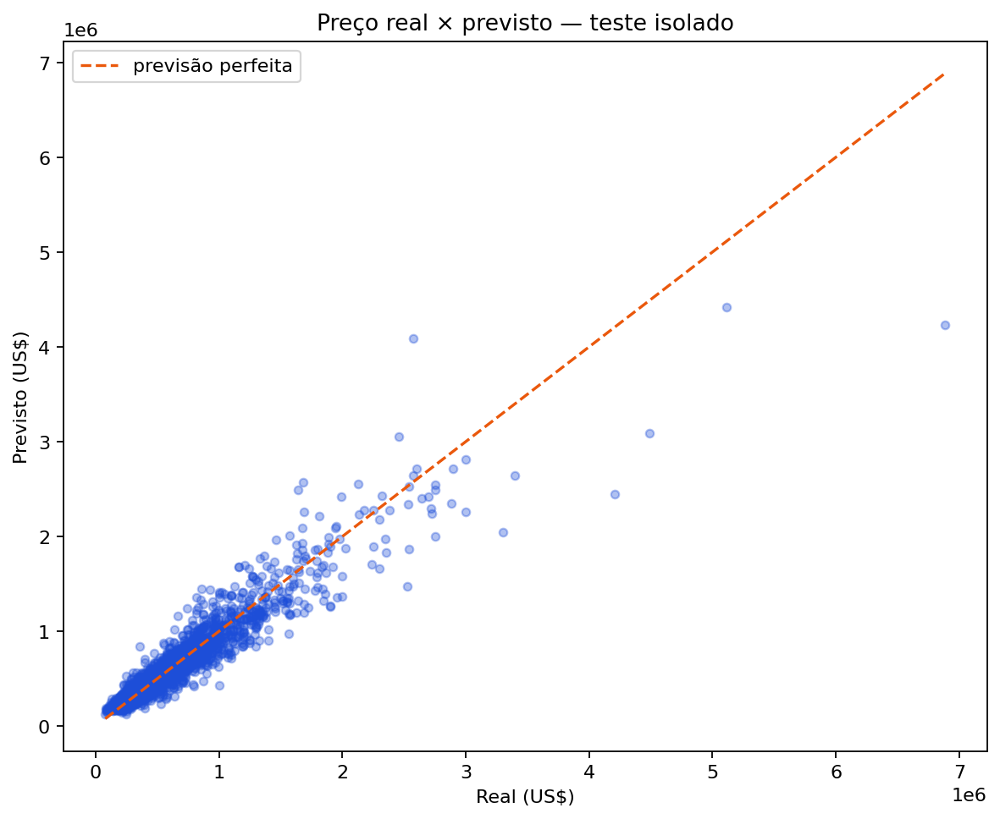<br><b>Teste isolado</b><br><sub>O alinhamento é mais forte na faixa central do mercado.</sub></td>
  </tr>
  <tr>
    <td width="50%" valign="top" align="center">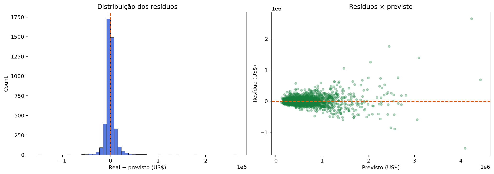<br><b>Resíduos</b><br><sub>A dispersão aumenta no segmento de maior valor.</sub></td>
    <td width="50%" valign="top" align="center">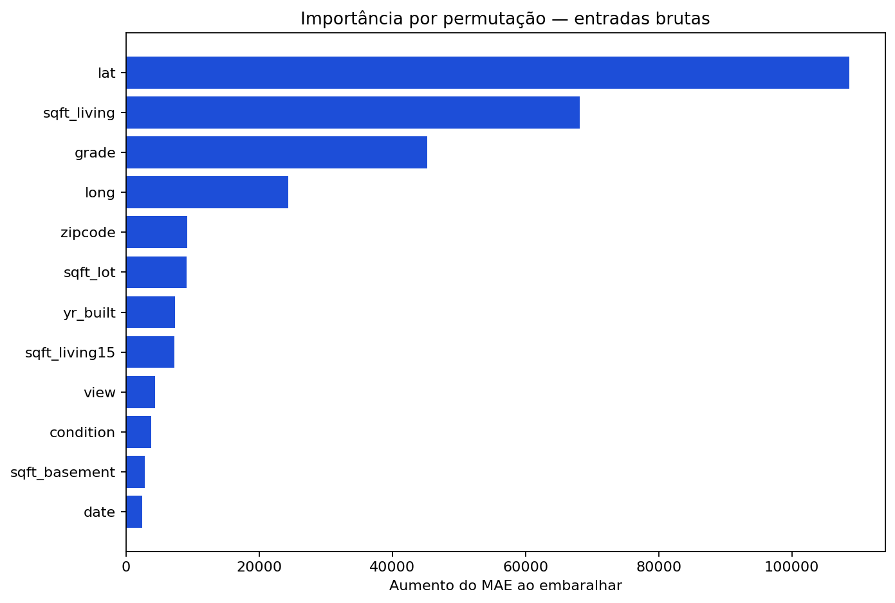<br><b>Dependência preditiva</b><br><sub>Localização, área e padrão concentram o sinal preditivo.</sub></td>
  </tr>
</table>

<details>
  <summary><strong>Ver diagnósticos exploratórios complementares</strong></summary>
  <br>
  <table class="visual-grid" width="100%">
    <tr>
      <td width="50%" valign="top" align="center">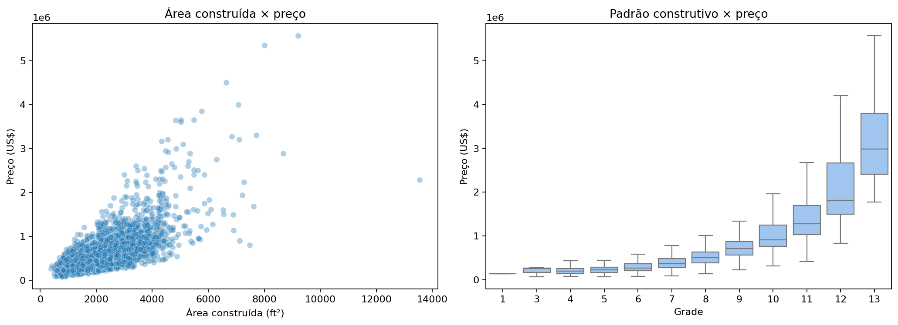<br><b>Relações com o alvo</b></td>
      <td width="50%" valign="top" align="center">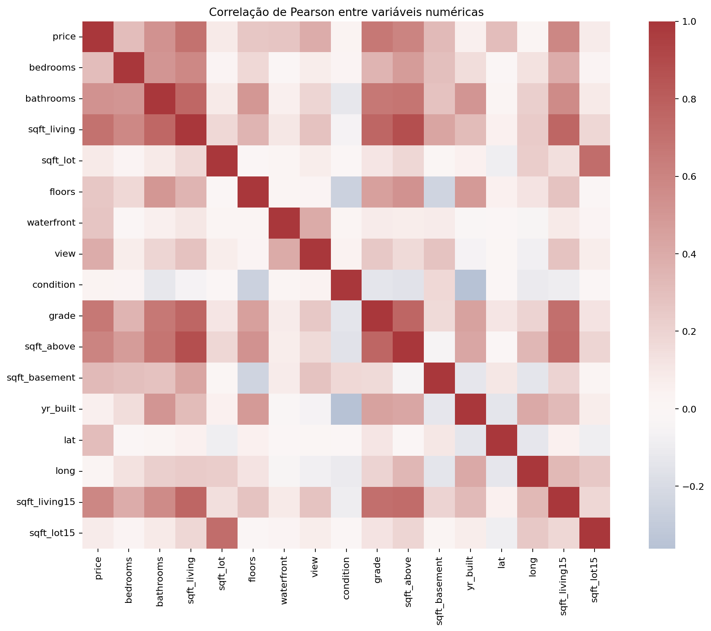<br><b>Correlação numérica</b></td>
    </tr>
    <tr>
      <td colspan="2" align="center">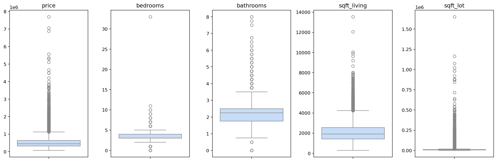<br><b>Extremos e consistência</b></td>
    </tr>
  </table>
</details>

### Variáveis de maior importância no teste

O valor abaixo representa quanto o MAE aumenta, em média, quando a variável é embaralhada. A medida é preditiva e não deve ser interpretada como efeito causal.

| Variável | Aumento médio do MAE |
|---|---:|
| `lat` | US$ 108.611 |
| `sqft_living` | US$ 68.161 |
| `grade` | US$ 45.221 |
| `long` | US$ 24.396 |
| `zipcode` | US$ 9.192 |
| `sqft_lot` | US$ 9.141 |
| `yr_built` | US$ 7.356 |
| `sqft_living15` | US$ 7.277 |

### Tabelas e relatórios reproduzíveis

| Artefato | Evidência preservada |
|---|---|
| [`correlacoes_pearson_spearman.csv`](outputs/correlacoes_pearson_spearman.csv) | associações lineares e monotônicas com o alvo |
| [`diagnostico_distribuicao_alvo.csv`](outputs/diagnostico_distribuicao_alvo.csv) | redução mensurada da assimetria e da curtose após `log1p` |
| [`vif_antes.csv`](outputs/vif_antes.csv) e [`vif_depois.csv`](outputs/vif_depois.csv) | redução documentada da multicolinearidade |
| [`cv_modelos_folds.csv`](outputs/cv_modelos_folds.csv) | resultado de cada candidato em cada fold agrupado |
| [`cv_modelos_resumo.csv`](outputs/cv_modelos_resumo.csv) | médias e desvios usados na seleção do campeão |
| [`vitorias_por_fold.csv`](outputs/vitorias_por_fold.csv) | vencedor por RMSE em cada uma das cinco divisões |
| [`metricas_modelos.csv`](outputs/metricas_modelos.csv) | métricas de treino e teste dos quatro modelos |
| [`diagnostico_generalizacao.csv`](outputs/diagnostico_generalizacao.csv) | gaps de erro e R² fora da amostra |
| [`erros_por_faixa_preco.csv`](outputs/erros_por_faixa_preco.csv) | erro segmentado pelos quartis do preço real |
| [`resumo_residuos.json`](outputs/resumo_residuos.json) | centro, dispersão e proporções de erro absoluto |
| [`importancia_permutacao.csv`](outputs/importancia_permutacao.csv) | importância e desvio das 19 variáveis explicativas |
| [`relatorio_qualidade_dados.json`](outputs/relatorio_qualidade_dados.json) | auditoria e tratamentos de qualidade aplicados |
| [`regioes_h3_valor_m2.csv`](outputs/maps/regioes_h3_valor_m2.csv) | 290 células, amostra, preço, área, IQR e decil superior |
| [`resumo_mapa_valor_m2.json`](outputs/maps/resumo_mapa_valor_m2.json) | resolução, cobertura, escala e limiar espacial |

---

## 15. Veredito de negócio

| Aplicação | Veredito |
|---|---|
| Triagem e priorização do portfólio | adequado |
| Faixa inicial de anúncio | adequado como apoio |
| Identificação de preços muito discrepantes | adequado |
| Fechamento do preço final | inadequado sem avaliação humana |
| Financiamento ou garantia | inadequado como única evidência |
| Imóveis de alto padrão | encaminhar para avaliação especializada |

---

## 16. Versionamento do modelo — v1

A pasta `models/v1/` contém:

- [`modelo_regressao_v1.pkl`](models/v1/modelo_regressao_v1.pkl?raw=1): engenharia de atributos sobre o esquema bruto, `ColumnTransformer`, transformação logarítmica do alvo, correção de retransformação e HistGradientBoosting retreinados nas 21.613 vendas;
- [`metricas_v1.json`](models/v1/metricas_v1.json?raw=1): data UTC do treinamento, configuração, validação cruzada, métricas do holdout e 19 variáveis explicativas.

As métricas registradas permanecem as do teste isolado; elas não são recalculadas sobre a base completa. Uma alteração de dados, features ou algoritmo deve gerar uma nova pasta (`v2`, `v3`), preservando a comparação.

### Estratégia de branches

| Branch | Responsabilidade | Regra de integração |
|---|---|---|
| `main` | versão estável destinada à entrega | recebe a solução somente após benchmark e auditoria final |
| `develop` | integração das fases acadêmicas e da documentação | recebe checkpoints reais e o experimento aprovado |
| `experiment/modelos` | comparação entre a média do treino, Regressão Linear, HistGradientBoosting e variante logarítmica | merge `--no-ff` na `develop` somente após o resultado de validação cruzada |

O experimento é funcional: caso um candidato não supere o baseline de forma consistente, sua branch não precisa ser integrada. Neste projeto, a variante logarítmica venceu os cinco folds e justificou o merge, preservando a `main` até a conclusão das demais verificações.

---

## 17. Como executar

### Ambiente único

O projeto é desenvolvido, executado e versionado exclusivamente no **Google Colab**. Não é necessário configurar Python, Jupyter ou ambiente virtual local.

Para reproduzir a versão pública:

1. abra o notebook pelo botão **Abrir no Google Colab**;
2. escolha **Ambiente de execução → Executar tudo**;
3. aguarde a primeira célula de código instalar somente dependências ausentes, baixar a base pública do Google Drive e validar seu SHA-256;
4. confira a execução sequencial das seis fases e os artefatos regenerados em `outputs/` e `models/v1/`.

A cópia acadêmica é autônoma: não exige upload manual, montagem do Drive, autenticação no Google ou token do GitHub; basta conexão à internet e acesso público de leitura ao repositório e ao dataset. No fluxo privado, o mesmo notebook contém temporariamente os comandos Git: as fases iniciais são registradas na `develop`, a comparação de modelos ocorre em `experiment/modelos`, o benchmark integral roda em um runtime novo e a `main` só é consolidada depois da sanitização e da auditoria.

### Política das células

| Tipo | Permanece na entrega? | Conteúdo |
|---|---|---|
| Acadêmica | sim | 15 células de código: numeração principal 0–10, com células de apoio visual e geoespacial na Fase 1 |
| Operacional temporária | não | sessão, autenticação, checkpoint, criação de branch, merges, benchmark e auditoria durante a construção |

O repositório público rastreia apenas um `.ipynb`. As células operacionais são removidas da versão indexada em cada checkpoint e da cópia final; credenciais nunca aparecem no notebook, no remote, nas saídas ou no histórico.

### Carregamento e previsão

```python
import joblib
import pandas as pd

modelo = joblib.load("models/v1/modelo_regressao_v1.pkl")
novos = pd.read_csv("novos_imoveis.csv")
previsoes = modelo.predict(novos)
```

`novos_imoveis.csv` deve seguir o esquema bruto das 19 entradas listadas em `metricas_v1.json`. `id` e `price` não são exigidos: correção contextual, engenharia de atributos, imputação, escala, encoding e previsão são executados pelo próprio pipeline.

---

## 18. Dependências e reprodutibilidade

| Biblioteca | Versão | Finalidade |
|---|---:|---|
| Python | 3.12.x | linguagem e execução; versão efetiva registrada ao final |
| Pandas | 2.2.3 | carga, limpeza e exportação |
| NumPy | 2.3.5 | operações numéricas e resíduos |
| scikit-learn | 1.8.0 | divisão, preprocessamento, modelos, métricas e validação |
| Matplotlib | 3.10.8 | gráficos |
| Seaborn | 0.13.2 | visualizações estatísticas |
| SciPy | 1.17.0 | suporte científico |
| Joblib | 1.5.3 | serialização do modelo |
| H3 | 4.5.0 | indexação geoespacial hexagonal |
| Plotly | 6.8.0 | prévia H3 incorporada ao notebook |
| Jinja2 | 3.1.6 | formatação das tabelas analíticas no notebook |
| Leaflet | 1.9.4 | painel cartográfico standalone carregado no navegador |

Controles de reprodução:

- Google Colab como único ambiente de desenvolvimento e execução;
- funções acadêmicas incorporadas ao notebook e dataset público carregado do Google Drive, sem upload manual; o CSV só é aceito após conferência SHA-256;
- verificação prévia das bibliotecas, com instalação somente das dependências ausentes ou abaixo da versão mínima;
- base bruta preservada em `data/raw/`;
- `random_state=42` nas divisões e nos modelos;
- holdout e folds agrupados por `id`;
- transformações ajustadas somente no treino de cada divisão;
- dependências fixadas em `requirements.txt`;
- ambiente efetivo registrado em `environment_info.json`;
- painel espacial reproduzido a partir de coordenadas e limite oficial do condado, sem token cartográfico;
- notebook entregue com seis fases avaliativas explícitas, conclusão e nenhuma célula operacional;
- checkpoints graduais realizados na `develop` e em `experiment/modelos`, imediatamente após cada fase e com timestamp real;
- experimento integrado à `develop` por merge `--no-ff` somente após a comparação dos candidatos;
- execução integral cronometrada em runtime novo do Colab antes da consolidação;
- duração, versão do Python e status gravados em `outputs/tempo_execucao_colab.json` nessa validação;
- integração da `develop` na `main` por merge commit, somente após a sanitização e a auditoria final.

---

## 19. Limitações

| Limitação | Impacto |
|---|---|
| Vendas de 2014–2015 | não incorpora inflação nem mudanças recentes do mercado |
| Base restrita a King County | não sustenta generalização automática para outras regiões |
| Atributos externos ausentes | escolas, transporte, ruído e micro-localização podem explicar erro restante |
| Erro heterogêneo | imóveis caros têm erro absoluto maior |
| Previsão pontual | não oferece intervalo individual de incerteza |
| Validação aleatória agrupada | não substitui uma validação temporal para implantação futura |
| Importância por permutação | mede dependência preditiva, não causalidade |

---

## 20. Roadmap de evolução: venda, aluguel e short stay

A base de 2014–2015 permanece útil como **benchmark histórico e acadêmico**, não como fotografia do mercado atual. A próxima versão deve começar pela ingestão contínua de dados recentes e reservar o período mais novo como teste fora do tempo. Assim, o projeto deixa de apenas estimar o preço de venda e evolui para uma plataforma de decisão imobiliária com três produtos conectados.

### 20.1 Produtos preditivos e financeiros

| Produto | Alvos modelados | Saída útil para decisão |
|---|---|---|
| Valor de venda | preço de transação e preço por m² ajustado por tipologia e localização | valor justo, intervalo de incerteza e comparação com imóveis semelhantes |
| Aluguel tradicional | aluguel mensal, probabilidade de vacância e tempo esperado até locação | receita anual ajustada à vacância, yield bruto e renda líquida estimada |
| Airbnb / short stay | diária média (`ADR`) e taxa de ocupação, modeladas separadamente por data e microrregião | receita por cenário, sazonalidade, noites vendidas e risco de baixa ocupação |
| Investimento | fluxo de caixa depois de despesas, financiamento e impostos | `NOI`, cap rate, cash-on-cash, `DSCR`, valor presente líquido, TIR e prazo de retorno |

Para short stay, a projeção bruta deve ser calculada como `ADR × noites disponíveis × ocupação`. O fluxo líquido precisa descontar taxa da plataforma, gestão, limpeza não repassada, utilidades, condomínio, seguro, impostos, manutenção, reposição de mobiliário, vacância e restrições locais. A apresentação correta é por cenários conservador, base e otimista; não como promessa de “renda passiva”.

### 20.2 Dados atuais e arquitetura espacial

1. **Atualização ponto no tempo:** formar snapshots mensais ou semanais de anúncios, transações, disponibilidade e atributos vigentes na data da previsão. Isso impede que uma informação posterior à venda ou à reserva vaze para o treino.
2. **Fontes complementares:** combinar registros cadastrais e de transações com [HUD FMR/SAFMR](https://www.huduser.gov/portal/datasets/fmr.html), [Zillow ZORI](https://www.zillow.com/research/data/) e dados públicos ou licenciados de short stay, como os conjuntos documentados pelo [Inside Airbnb](https://insideairbnb.com/get-the-data/). Coleta automatizada só deve ocorrer quando licença e termos de uso permitirem.
3. **Contexto urbano e de risco:** acrescentar tempo de viagem a polos de emprego, transporte, escolas, amenidades, zoneamento, licenças de hospedagem, ruído, criminalidade agregada, enchente, incêndio, clima, eventos, feriados, juros e indicadores de renda e emprego.
4. **Camadas geoespaciais:** armazenar parcelas, pontos de interesse, isócronas e células H3 em PostgreSQL com [PostGIS](https://postgis.net/docs/); usar índices espaciais, vizinhança e distâncias calculadas no banco, preservando a geografia válida em cada data.
5. **Processamento reproduzível:** manter zonas `raw`, `validated` e `features`; usar SQL/[dbt](https://docs.getdbt.com/docs/introduction) para transformações auditáveis, [DuckDB Spatial](https://duckdb.org/docs/stable/core_extensions/spatial/overview) e [Polars](https://docs.pola.rs/) para análise local eficiente, e [DVC](https://dvc.org/doc) para versionar referências dos dados sem inflar o Git.
6. **Atributos multimodais:** quando houver autorização e histórico suficiente, extrair sinais de descrições, fotografias e plantas para representar conservação, luminosidade, vista e padrão de acabamento. Esses atributos devem respeitar licença, privacidade e data de disponibilidade, e só permanecem se melhorarem o backtest fora do tempo.

### 20.3 Validação e modelagem de segunda geração

- Substituir a validação aleatória como evidência de implantação por **backtesting com origem móvel**: vários cortes cronológicos, imóvel agrupado por `id` e último período totalmente intocado. Acrescentar blocos espaciais para medir desempenho em regiões não vistas ou pouco representadas.
- Preservar um baseline hedônico interpretável e comparar [CatBoost](https://catboost.ai/docs/en/), [LightGBM](https://lightgbm.readthedocs.io/en/stable/) e [XGBoost](https://xgboost.readthedocs.io/en/stable/). O ajuste com [Optuna](https://optuna.readthedocs.io/en/stable/) deve ocorrer apenas dentro do treino; complexidade só é aceita quando melhora o teste temporal e espacial.
- Estimar quantis e aplicar predição conformal com [MAPIE](https://mapie.readthedocs.io/en/latest/) para fornecer intervalos de 80% e 90%. Além de MAE e RMSE, acompanhar cobertura, largura média do intervalo e cobertura por ZIP, faixa de preço e tipo de imóvel.
- Para aluguel tradicional, modelar simultaneamente valor mensal e vacância. Para short stay, adotar arquitetura em duas etapas — ocupação e `ADR` — com variáveis de calendário, eventos, defasagens e oferta concorrente; modelos profundos de séries temporais só entram se houver histórico longitudinal suficiente para superar os métodos tabulares.
- Investigar o erro espacial remanescente com econometria e modelos hierárquicos em **R** (`sf`, `spdep`, `brms`) ou Python (`PyMC`). Essa trilha serve para quantificar efeitos por bairro e dependência espacial, não para substituir automaticamente o melhor preditor validado.
- Separar previsão de causalidade: estimar o valor de um imóvel é uma tarefa; medir retorno de reforma, piscina ou mudança regulatória exige desenho causal próprio, com grupos comparáveis e hipóteses declaradas.

### 20.4 Stack profissional sugerido

| Camada | Tecnologias | Papel no sistema |
|---|---|---|
| Dados e geografia | SQL, PostgreSQL/PostGIS, dbt, DuckDB Spatial, Polars | ingestão incremental, contratos, consultas espaciais e criação de atributos |
| Ciência de dados | Python/scikit-learn, CatBoost, LightGBM, XGBoost, MAPIE; R para auditoria espacial e bayesiana | modelos pontuais, intervalos, sazonalidade e diagnóstico |
| Qualidade e versionamento | [Pandera](https://pandera.readthedocs.io/en/stable/), testes dbt, DVC e GitHub Actions | validar esquema, impedir regressões e ligar código à versão dos dados |
| Experimentos e modelos | [MLflow Tracking e Model Registry](https://mlflow.org/docs/latest/ml/model-registry/) | rastrear parâmetros, métricas, linhagem, versões e aliases `champion`/`challenger` |
| Orquestração | [Prefect](https://docs.prefect.io/v3/get-started) | agendar ingestão, treinamento, avaliação e publicação com retries observáveis |
| Serviço | [FastAPI](https://fastapi.tiangolo.com/), [Docker](https://docs.docker.com/) e armazenamento de objetos | disponibilizar previsões versionadas com contrato de entrada e rollback |
| Experiência geoespacial | TypeScript, React e MapLibre GL JS | simulador responsivo com mapa, cenários, comparáveis e intervalos |
| Monitoramento | [Evidently](https://docs.evidentlyai.com/docs/platform/monitoring_overview), testes de distribuição e alertas de negócio | detectar drift de dados, degradação de erro, queda de cobertura e descalibração |

Uma feature store como Feast e processamento distribuído com Spark só se justificam quando houver múltiplos consumidores, baixa latência ou volume que ultrapasse a arquitetura SQL/DuckDB. Antecipar essa complexidade no volume atual aumentaria custo sem evidência de ganho.

### 20.5 Sequência recomendada e critérios de promoção

| Prioridade | Entrega | Critério para avançar |
|:---:|---|---|
| P0 | dados atuais, contratos de esquema, snapshots ponto no tempo e catálogo de fontes/licenças | atualização reproduzível, sem vazamento e com cobertura temporal e espacial medida |
| P1 | modelo de venda v2 com boosting, validação temporal-espacial e intervalos conformais | reduzir erro fora do tempo e atingir cobertura nominal por segmento sem intervalos impraticáveis |
| P2 | modelos de aluguel mensal, ocupação e `ADR`; motor de custos e cenários | erro estável por estação e região, cálculos financeiros reconciliáveis e premissas editáveis |
| P3 | API, painel de investimento e camada cartográfica em TypeScript/MapLibre | resposta versionada, rastreável e consistente entre API, mapa e relatório financeiro |
| P4 | pipeline automatizado, registro de modelos e monitoramento `champion/challenger` | promover somente quando o candidato superar o campeão em métricas técnicas e de negócio |

O resultado esperado não é apenas um algoritmo com R² maior. É um sistema que informa **quanto um imóvel pode valer, quanto pode render, qual a incerteza da estimativa e quais premissas alteram o retorno**, com rastreabilidade suficiente para explicar cada cenário.

---

## 21. Transparência sobre uso de IA

Ferramentas de inteligência artificial foram utilizadas como apoio auxiliar na organização, revisão e aprimoramento da apresentação do projeto, mantendo a responsabilidade técnica e autoral do aluno. As decisões de tratamento, modelagem, validação e interpretação foram conferidas pelo autor a partir dos dados e das evidências reproduzíveis disponibilizadas neste repositório.

**Módulo 2.** Ferramentas de inteligência artificial também foram usadas como apoio no desenvolvimento da API e do portal web: estruturação das camadas, depuração, revisão do código e da documentação. O uso foi supervisionado pelo autor, que definiu os requisitos, revisou cada entrega, executou os testes e responde tecnicamente por todo o código submetido, como demonstrado no vídeo de apresentação.

---

## 22. Fonte, licença e autor

Dataset fornecido no enunciado do projeto: `kc_house_data.csv`.

Licença MIT — consulte [`LICENSE`](LICENSE).

**Ricardo Pasquali dos Reis**
Desenvolvimento em IA para Análise Preditiva
